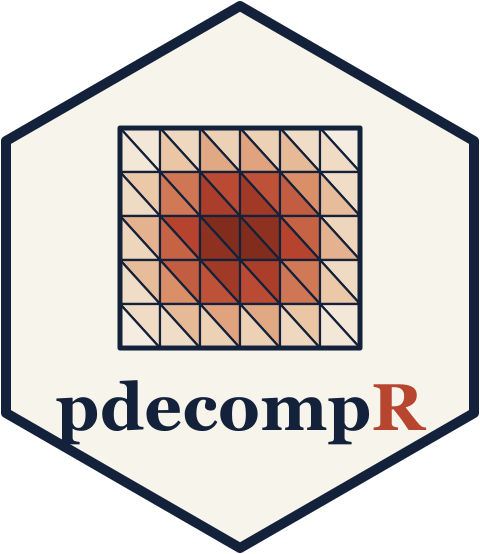

# pdecompR: Partial Differential Equations and Finite-Element Computing in R 

<!-- badges: start -->
[](https://github.com/adamrsophie/pdecompR/actions/workflows/R-CMD-check.yaml)
[](https://app.codecov.io/gh/adamrsophie/pdecompR)
[](https://adamrsophie.github.io/pdecompR/)
[](https://lifecycle.r-lib.org/articles/stages.html#experimental)
[](https://www.gnu.org/licenses/gpl-3.0)
<!-- DOI badge: Zenodo mints a concept DOI on the first GitHub release; replace XXXXXXXX and uncomment. -->
<!-- [](https://doi.org/10.5281/zenodo.XXXXXXXX) -->
<!-- badges: end -->

***pdecompR*** is an R-native framework for defining, discretizing, solving
and analyzing partial differential equations with the finite-element method.
Its design follows the path

**geometry, mesh, finite-element space, weak form, assembly, solver,
solution, error estimation, sensitivity, optimization**,

in the spirit of [FEniCSx](https://fenicsproject.org) and
[Gridap.jl](https://github.com/gridap/Gridap.jl), but everything runs in R:
there is no Python, no Julia and no compiled code. Sparse linear algebra comes
from the [Matrix](https://cran.r-project.org/package=Matrix) package
(CHOLMOD and sparse LU).

## Installation

```r
# install.packages("remotes")
remotes::install_github("adamrsophie/pdecompR")
```

## Quick start

Solve `-Laplace(u) = f` on the unit square with `u = 0` on the boundary,
where `f` is chosen so that `u = sin(pi x) sin(pi y)`:

```r
library(pdecompR)

mesh <- pde_mesh_rectangle(x = c(0, 1), y = c(0, 1), nx = 32, ny = 32)

problem <- poisson_problem(
  mesh = mesh,
  diffusion = 1,
  source = function(x, y) 2 * pi^2 * sin(pi * x) * sin(pi * y),
  boundary = dirichlet_bc(value = 0, marker = "boundary")
)

solution <- solve_pde(problem)
summary(solution)
plot(solution)

exact <- function(x, y) sin(pi * x) * sin(pi * y)
errornorm(solution, exact, "L2")
```

A mesh refinement study confirms the expected orders:

```r
convergence_study(problem, exact, mesh_sizes = c(8, 16, 32, 64))
```

The same problem in the weak-form language:

```r
V <- fe_space(mesh, degree = 2)
u <- trial_function(V)
v <- test_function(V)
a <- integrate_domain(dot(grad(u), grad(v)))
f <- function(x, y) 2 * pi^2 * sin(pi * x) * sin(pi * y)
L <- integrate_domain(f * v)
solve_pde(variational_problem(a, L, dirichlet_bc(0)))
```

## What is implemented

| Area | Functionality |
|------|---------------|
| Geometry and meshes | rectangles and simple polygons, with holes; structured meshes (three diagonal patterns); polygon meshes (ear clipping, Delaunay flips, refinement); validation of connectivity, orientation, degeneracy, geometric overlap and boundary markers; quality measures; subdomain regions with piecewise coefficients; Gmsh 2.2 and 4.1 import (physical lines and surfaces); VTK export (legacy and XML `.vtu`, P1 and quadratic P2 cells, vectors, stresses) and `.pvd` time series |
| Finite elements | continuous Lagrange P1 and P2 on triangles, scalar and vector valued; interpolation, L2 projection between unrelated meshes of the same domain (globally conservative), point evaluation, observation matrices |
| Quadrature | Gauss-Legendre on intervals; triangle rules exact to any degree |
| Assembly | sparse triplet assembly of stiffness, mass, advection and boundary matrices, load vectors, variable tensor diffusion; reference-element kernels for elementwise constant coefficients |
| Boundary conditions | Dirichlet (by elimination, keeps SPD), Neumann, Robin, periodic; pure Neumann problems with compatibility check and a zero-mean gauge on each connected component |
| Linear solvers | sparse Cholesky and LU with symmetric scaling; CG, BiCGSTAB and GMRES with Jacobi, SSOR, geometric multigrid or user preconditioners; block right-hand sides; residual diagnostics |
| PDE classes | elliptic (diffusion, advection, reaction), linear elasticity (vector P1/P2, plane strain and stress, stress and von Mises output), SUPG stabilization, heat and parabolic problems (backward Euler, Crank-Nicolson, BDF2, adaptive SDIRK2, time-dependent coefficients, mass diagnostics), damped waves and elastodynamics (energy-conserving Newmark), eigenvalue problems, Stokes flow (Taylor-Hood P2-P1 with a block preconditioner), reaction-diffusion systems (IMEX, Newton), quasilinear diffusion, semilinear reaction, p-Laplacian |
| Weak forms | `trial_function()`, `test_function()`, `grad()`, `dot()`, `integrate_domain()`, `integrate_boundary()` |
| Verification | L2, H1 and energy errors, convergence studies with observed orders, symbolic manufactured solutions through symcompR, a reference benchmark suite |
| Adaptivity | residual error estimator, Doerfler marking, newest vertex bisection, adaptive loop |
| Inference | discrete forward and adjoint sensitivities (linear, nonlinear and time-dependent), analytic affine derivatives, Taylor remainder tests, parameter estimation with adjoint gradients and identifiability diagnostics, distributed optimal control |

Not available: three-dimensional and one-dimensional meshes, curved
boundaries, discontinuous Galerkin methods, nonlinear weak forms, and
parallel or GPU backends.

## Validation

Every solver is verified against analytical solutions in the test suite.
Observed orders on the unit square with `u = sin(pi x) sin(pi y)`:

| Element | meshes | L2 order | H1 order |
|---------|--------|----------|----------|
| P1 | 8, 16, 32 | 1.97, 1.99 | 0.99, 1.00 |
| P2 | 8, 16, 32 | 2.98, 3.00 | 1.95, 1.99 |

Affine solutions are reproduced to rounding error; Crank-Nicolson and
backward Euler show temporal orders 2 and 1; Newton's method converges
quadratically on quasilinear problems; adaptive refinement on the L-shaped
domain recovers the optimal rate that uniform refinement loses.

## Related packages

pdecompR belongs to a family of R packages by the same author:
[symcompR](https://github.com/adamrsophie/symcompR) (symbolic computation),
[modelcompR](https://github.com/adamrsophie/modelcompR) (equation-based
modeling), [jaxR](https://github.com/adamrsophie/jaxR) (differentiable
computation), [z3r](https://github.com/adamrsophie/z3r) (constraint solving)
and [optcompR](https://github.com/adamrsophie/optcompR) (optimization).
pdecompR works on its own; integrations with these packages are planned and
will stay optional.

## License

GPL-3.
