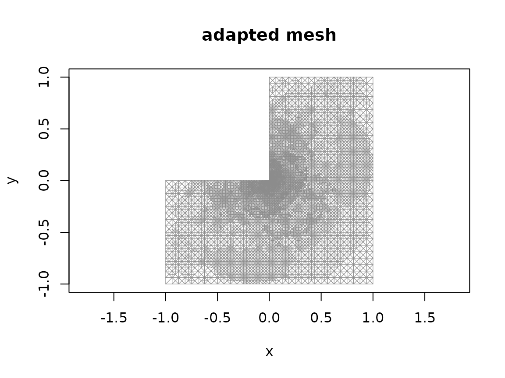
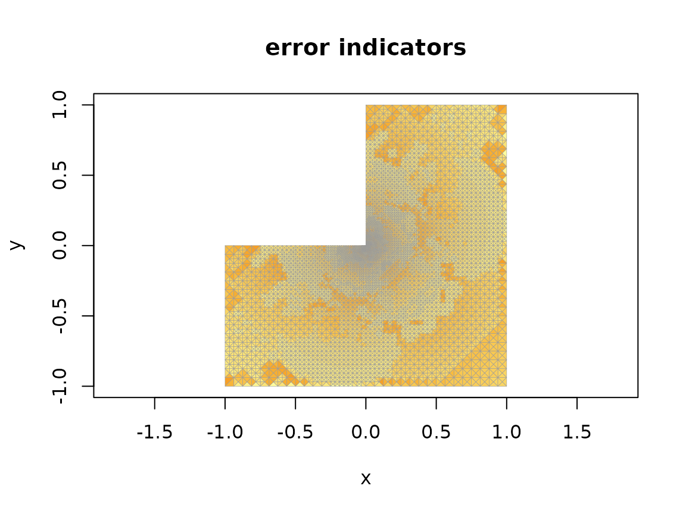
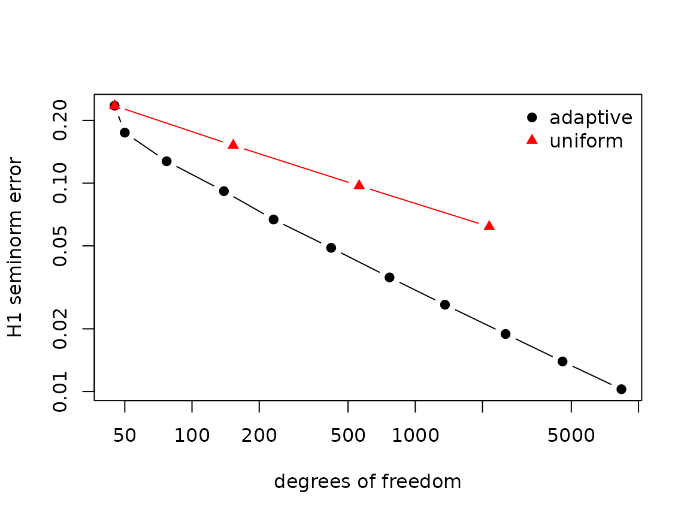

# Error estimation and adaptive refinement

``` r

library(pdecompR)
```

## Why adapt

The a priori estimate \|u - u_h\|\_{H^1} \le C h\\\|u\|\_{H^2} assumes a
smooth solution. Near reentrant corners, the solution has a singularity
and uniform refinement converges more slowly. Adaptive methods refine
where the error is large, guided by an *a posteriori* estimator computed
from u_h and the data.

## The residual estimator

For -\nabla\cdot(k\nabla u) + b\cdot\nabla u + cu = f,
[`estimate_error()`](https://adamrsophie.github.io/pdecompR/reference/estimate_error.md)
computes, for every element T,

\eta_T^2 = h_T^2\\\\f - cu_h - b\cdot\nabla u_h + \nabla\cdot(k\nabla
u_h)\\\_T^2 + \tfrac12\sum\_{E\subset\partial T\\ \text{interior}}
h_E\\\\\[k\nabla u_h\cdot n\]\\\_E^2 + \sum\_{E\subset\partial
T\cap\Gamma_N} h_E\\\\h - k\nabla u_h\cdot n\\\_E^2 .

The first term measures how far u_h is from satisfying the PDE inside
elements; the second measures the jump of the normal flux across edges.
Up to constants, \eta = (\sum_T\eta_T^2)^{1/2} bounds the energy error
from above and below for diffusion-dominated problems.

On a smooth problem, estimator and error decrease together:

``` r

exact <- function(x, y) sin(pi * x) * sin(pi * y)
gradient <- function(x, y) cbind(pi * cos(pi * x) * sin(pi * y), pi * sin(pi * x) * cos(pi * y))
f <- function(x, y) 2 * pi^2 * exact(x, y)
prob <- poisson_problem(pde_mesh_rectangle(nx = 4), source = f, boundary = dirichlet_bc(0))
t(sapply(c(8, 16, 32), function(n) {
  s <- solve_pde(update_mesh(prob, pde_mesh_rectangle(nx = n)))
  e <- estimate_error(s)$total; err <- errornorm(s, exact, "H1_semi", gradient = gradient)
  c(n = n, estimator = e, H1_error = err, ratio = e / err)
}))
#>       n estimator  H1_error    ratio
#> [1,]  8 2.3863137 0.4317983 5.526455
#> [2,] 16 1.2183397 0.2175363 5.600626
#> [3,] 32 0.6137031 0.1089754 5.631573
```

The ratio (the effectivity index) is nearly constant.

## Marking and refinement

[`mark_elements()`](https://adamrsophie.github.io/pdecompR/reference/mark_elements.md)
implements Doerfler marking: choose a smallest set \mathcal M with
\sum\_{T\in\mathcal M}\eta_T^2 \ge \theta\sum_T\eta_T^2.
[`refine_mesh()`](https://adamrsophie.github.io/pdecompR/reference/refine_uniform.md)
then bisects the marked elements by newest vertex bisection, adding
refinement of neighbors so that the mesh stays conforming.

## The L-shaped domain

On \Omega = (-1, 1)^2 without the upper left quadrant, the harmonic
function u = r^{2/3}\sin(2\varphi/3) (angle \varphi measured from the
negative x axis) has an unbounded gradient at the reentrant corner.
Uniform refinement converges like N^{-1/3} in terms of the number of
unknowns N; the optimal rate for P1 is N^{-1/2}.

``` r

Lv <- rbind(c(-1, -1), c(1, -1), c(1, 1), c(0, 1), c(0, 0), c(-1, 0))
phi <- function(x, y) (atan2(y, x) - pi) %% (2 * pi)
u_l <- function(x, y) sqrt(x^2 + y^2)^(2 / 3) * sin(2 * phi(x, y) / 3)
g_l <- function(x, y) {
  r <- sqrt(x^2 + y^2); th <- atan2(y, x); ph <- phi(x, y); a <- 2 / 3 * r^(-1 / 3)
  cbind(a * (sin(2 * ph / 3) * cos(th) - cos(2 * ph / 3) * sin(th)),
        a * (sin(2 * ph / 3) * sin(th) + cos(2 * ph / 3) * cos(th)))
}
m0 <- pde_mesh_polygon(Lv, h = 0.5)
probL <- poisson_problem(m0, source = 0, boundary = dirichlet_bc(u_l))

ad <- adaptive_solve(probL, theta = 0.5, max_iterations = 14, max_dofs = 5000,
                     exact = u_l, gradient = g_l)
ad
#> Adaptive finite-element solution
#>  iteration ndof elements estimator  error_L2 error_H1_semi
#>          0   45       64   0.83538 2.035e-02       0.23525
#>          1   50       74   0.54279 1.233e-02       0.17478
#>          2   77      126   0.40454 6.221e-03       0.12736
#>          3  139      240   0.29523 3.545e-03       0.09154
#>          4  232      418   0.21865 1.830e-03       0.06692
#>          5  420      778   0.16142 9.673e-04       0.04895
#>          6  767     1454   0.11847 5.070e-04       0.03530
#>          7 1359     2616   0.08812 2.999e-04       0.02610
#>          8 2539     4936   0.06449 1.524e-04       0.01889
#>          9 4569     8952   0.04778 8.313e-05       0.01394
#>         10 8384    16534   0.03527 4.399e-05       0.01026
```

``` r

plot(ad$solution$space$mesh, markers = FALSE, main = "adapted mesh")
```



``` r

plot_indicators(ad$solution$space$mesh, estimate_error(ad$solution), main = "error indicators")
```



Compare with uniform refinement:

``` r

uni <- convergence_study(probL, u_l, g_l, refinements = 3, norms = "H1_semi")
uni
#> Mesh convergence study
#>       h ndof H1_semi rate_H1_semi
#>  0.5000   45 0.23525           NA
#>  0.2500  153 0.15177       0.6323
#>  0.1250  561 0.09714       0.6438
#>  0.0625 2145 0.06182       0.6519
h <- ad$history
plot(h$ndof, h$error_H1_semi, log = "xy", type = "b", pch = 19,
     xlim = range(c(h$ndof, uni$ndof)), ylim = range(c(h$error_H1_semi, uni$H1_semi)),
     xlab = "degrees of freedom", ylab = "H1 seminorm error")
lines(uni$ndof, uni$H1_semi, type = "b", pch = 17, col = "red")
legend("topright", c("adaptive", "uniform"), pch = c(19, 17), col = c("black", "red"), bty = "n")
```



``` r

k <- nrow(h)
c(adaptive_rate = log(h$error_H1_semi[k] / h$error_H1_semi[k - 4]) / log(h$ndof[k] / h$ndof[k - 4]),
  uniform_rate = log(uni$H1_semi[4] / uni$H1_semi[2]) / log(uni$ndof[4] / uni$ndof[2]))
#> adaptive_rate  uniform_rate 
#>      -0.51672      -0.34013
```

Adaptivity recovers the optimal rate -1/2, while uniform refinement
shows -1/3. Concentrating refinement is not automatically better,
though: on smooth problems uniform refinement is just as good and
cheaper per step, and an estimator that ignores important error sources
(for example strong advection) can mislead the marking.

## Solution transfer

[`refine_mesh()`](https://adamrsophie.github.io/pdecompR/reference/refine_uniform.md)
and
[`refine_uniform()`](https://adamrsophie.github.io/pdecompR/reference/refine_uniform.md)
record the parent edge of each new node;
[`transfer_function()`](https://adamrsophie.github.io/pdecompR/reference/transfer_function.md)
interpolates a function onto the refined mesh, exactly for P1. This is
what an adaptive time stepper or a nonlinear solver would use to warm
start on the new mesh.
