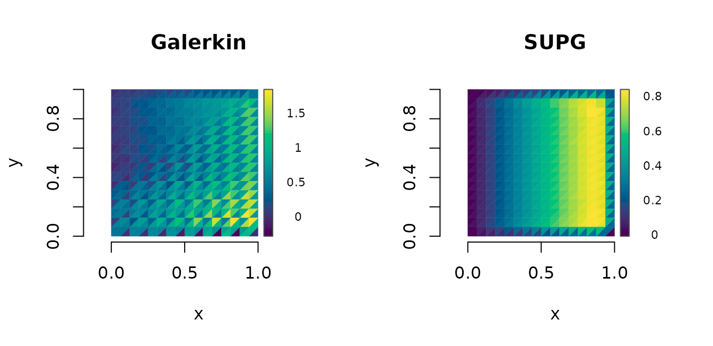
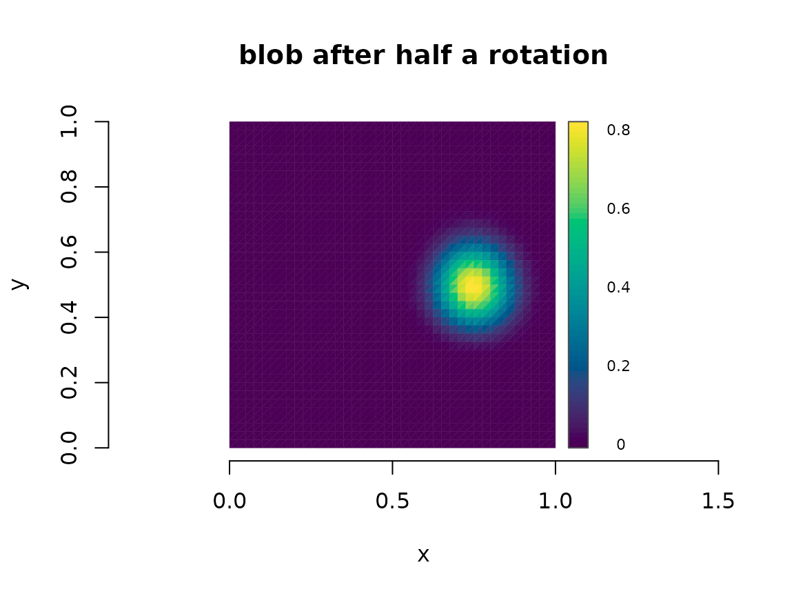

# Advection-diffusion and stabilization

``` r

library(pdecompR)
```

## The problem

-\nabla\cdot(k\nabla u) + b\cdot\nabla u + cu = f .

The element Peclet number \mathrm{Pe}\_T = \|b\|h_T/(2k) compares
advection to diffusion at the scale of the mesh. For \mathrm{Pe}\_T \le
1 the standard Galerkin method is accurate. For \mathrm{Pe}\_T \gg 1 it
remains stable in theory but produces spurious oscillations near layers
that the mesh does not resolve.

## Galerkin in the diffusive regime

``` r

exact <- function(x, y) sin(pi * x) * sin(pi * y)
grad_exact <- function(x, y) cbind(pi * cos(pi * x) * sin(pi * y), pi * sin(pi * x) * cos(pi * y))
k <- 0.1; b <- c(1, 0.5)
f <- function(x, y) {
  g <- grad_exact(x, y)
  k * 2 * pi^2 * exact(x, y) + b[1] * g[, 1] + b[2] * g[, 2]
}
prob <- elliptic_problem(pde_mesh_rectangle(nx = 4), diffusion = k, advection = b, source = f,
                         bcs = dirichlet_bc(0))
convergence_study(prob, exact, grad_exact, mesh_sizes = c(8, 16, 32))
#> Mesh convergence study
#>        h ndof        L2 H1_semi rate_L2 rate_H1_semi
#>  0.17678   81 0.0144953  0.4378      NA           NA
#>  0.08839  289 0.0035579  0.2183   2.026        1.004
#>  0.04419 1089 0.0008852  0.1091   2.007        1.001
```

The system is not symmetric, so the solver uses sparse LU:

``` r

solve_pde(prob)$diagnostics$solver$method
#> [1] "lu"
```

## Boundary layers at high Peclet number

With k = 10^{-3}, b = (1, 0), f = 1 and u = 0 on the boundary, the
solution grows like x and drops to zero in a thin layer at the outflow
boundary x = 1.

``` r

m <- pde_mesh_rectangle(nx = 16)
common <- list(mesh = m, diffusion = 1e-3, advection = c(1, 0), source = 1, bcs = dirichlet_bc(0))
gal <- solve_pde(do.call(elliptic_problem, common))
supg <- solve_pde(do.call(elliptic_problem, c(common, stabilization = "supg")))
op <- par(mfrow = c(1, 2))
plot(gal, main = "Galerkin")
plot(supg, main = "SUPG")
```



``` r

par(op)
rbind(Galerkin = range(gal$u$values), SUPG = range(supg$u$values))
#>                [,1]      [,2]
#> Galerkin -0.8081525 3.3572200
#> SUPG      0.0000000 0.8734344
```

Galerkin oscillates with amplitude far beyond the true range \[0, 1\];
SUPG does not.

## Streamline upwind Petrov-Galerkin

SUPG adds, element by element, the residual tested against the
streamline derivative of the test function:

\sum_T \tau_T \int_T (b\cdot\nabla u + cu - \nabla\cdot(k\nabla u) -
f)\\(b\cdot\nabla v)\\dx, \qquad \tau_T = \frac{h_T}{2\|b\|}\left(\coth
\mathrm{Pe}\_T - \frac{1}{\mathrm{Pe}\_T}\right).

The added term vanishes for the exact solution, so the method stays
consistent and keeps its convergence order. Its main effect is
artificial diffusion \tau_T\\b b^\top along the streamlines only. In
pdecompR, `stabilization = "supg"` is available for P1 elements (for
which the diffusion term in the residual vanishes elementwise with
constant k).

SUPG reduces but does not eliminate overshoots near sharp layers; it is
not a positivity-preserving scheme, and no such claim is made.

## Transient transport

[`parabolic_problem()`](https://adamrsophie.github.io/pdecompR/reference/parabolic_problem.md)
accepts the same advection field and stabilization; for transient
problems the SUPG residual includes \partial_t u, which adds
\tau_T\int_T \partial_t u\\(b\cdot\nabla v) to the mass matrix.

``` r

blob <- function(x, y) exp(-100 * ((x - 0.25)^2 + (y - 0.5)^2))
rot <- function(x, y) cbind(-(y - 0.5), x - 0.5) * 2 * pi
p <- parabolic_problem(pde_mesh_rectangle(nx = 40), diffusion = 1e-4, advection = rot,
                       initial = blob, bcs = dirichlet_bc(0), time = c(0, 0.5),
                       stabilization = "supg")
s <- solve_pde(p, dt = 0.01, output_times = c(0, 0.25, 0.5))
plot(s, time = 0.5, main = "blob after half a rotation")
```


