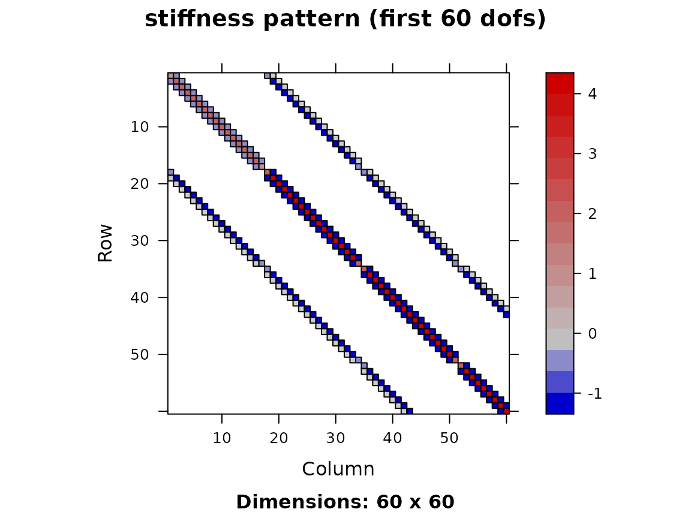

# Sparse assembly and linear solvers

``` r

library(pdecompR)
library(Matrix)
```

## Element loops without loops

Assembly computes, for every element T and every pair of local basis
functions,

A^T\_{ij} = \sum_q w_q \det B_T \left\[ c\\\phi_i\phi_j +
\phi_i\\(b\cdot\nabla\phi_j) + \nabla\phi_i^\top D\\\nabla\phi_j
\right\](\hat x_q),

with i the test index (row) and j the trial index (column). pdecompR
vectorizes over elements: the loops run over quadrature points and the
3\times3 (or 6\times6) local indices, while each operation acts on a
vector of length m (the number of elements). The local matrices are then
summed into a global sparse matrix through triplets (I, J, A^T\_{ij}),
which
[`Matrix::sparseMatrix()`](https://rdrr.io/pkg/Matrix/man/sparseMatrix.html)
accumulates into the compressed column format.

``` r

V <- fe_space(pde_mesh_rectangle(nx = 16))
K <- assemble_matrix(V, "stiffness")
M <- assemble_matrix(V, "mass")
C <- assemble_matrix(V, "advection", c(1, 0))
class(K); dim(K); nnzero(K)
#> [1] "dgCMatrix"
#> attr(,"package")
#> [1] "Matrix"
#> [1] 289 289
#> [1] 1377
```

The structure reflects the mesh connectivity:

``` r

image(K[1:60, 1:60], main = "stiffness pattern (first 60 dofs)")
```



## Properties worth checking

``` r

max(abs(K %*% rep(1, V$ndof)))   # constants are in the kernel of K
#> [1] 0
sum(M)                           # 1' M 1 is the area
#> [1] 1
isSymmetric(K); isSymmetric(M)
#> [1] TRUE
#> [1] TRUE
range(eigen(as.matrix(M), only.values = TRUE)$values)
#> [1] 0.0002663858 0.0038627258
```

The stiffness matrix with Dirichlet rows and columns removed is
symmetric positive definite; the advection matrix is not symmetric.

## Load vectors and boundary terms

``` r

b <- assemble_vector(V, function(x, y) x * y)
sum(b)                                            # int x y = 1/4
#> [1] 0.25
sum(assemble_boundary_vector(V, 1, "left"))       # length of the left edge
#> [1] 1
```

## Invariance under renumbering

Assembly does not depend on the order of nodes: renumbering the nodes
permutes the matrix.

``` r

m <- pde_mesh_rectangle(nx = 4)
perm <- sample(nrow(m$nodes)); inv <- order(perm)
m2 <- pde_mesh(m$nodes[perm, ], matrix(inv[m$triangles], ncol = 3))
K1 <- as.matrix(assemble_matrix(fe_space(m), "stiffness"))
K2 <- as.matrix(assemble_matrix(fe_space(m2), "stiffness"))
max(abs(K2 - K1[perm, perm]))
#> [1] 0
```

## Linear solvers

[`solve_linear_system()`](https://adamrsophie.github.io/pdecompR/reference/solve_linear_system.md)
chooses sparse Cholesky for symmetric matrices (with a fallback to
sparse LU when the matrix is not positive definite) and sparse LU
otherwise. Preconditioned conjugate gradients, BiCGSTAB and restarted
GMRES are also available.

``` r

A <- K + M
rhs <- assemble_vector(V, 1)
for (m in c("auto", "lu", "cg", "bicgstab", "gmres")) {
  s <- solve_linear_system(A, rhs, method = m, tol = 1e-12)
  cat(sprintf("%-8s %-9s iterations %4s  relative residual %.2e\n", m, s$info$method,
              s$info$iterations, s$info$relative_residual))
}
#> auto     cholesky  iterations   NA  relative residual 1.74e-13
#> lu       lu        iterations   NA  relative residual 1.85e-13
#> cg       cg        iterations   54  relative residual 4.67e-13
#> bicgstab bicgstab  iterations   43  relative residual 6.22e-13
#> gmres    gmres     iterations   54  relative residual 8.57e-13
```

Every solve reports a status, the residual and its relative size, the
iteration count, the matrix size and the number of nonzeros. Iterative
methods report `"not converged"` instead of returning silently:

``` r

solve_linear_system(A, rhs, method = "cg", maxit = 3)$info$status
#> [1] "not converged"
```

For repeated solves with the same matrix (time stepping),
[`linear_solver()`](https://adamrsophie.github.io/pdecompR/reference/solve_linear_system.md)
factors once and returns a reusable
[`solve()`](https://rdrr.io/pkg/Matrix/man/solve-methods.html) function.

## Cost

Assembly is linear in the number of elements, and so is the memory of
the sparse matrices. The supernodal Cholesky factorization of
two-dimensional finite-element matrices costs roughly O(N^{1.5})
operations with fill reducing orderings, which keeps meshes with 10^5 to
10^6 unknowns practical on a workstation.

``` r

for (n in c(32, 64, 128)) {
  mesh <- pde_mesh_rectangle(nx = n)
  t <- system.time(s <- solve_pde(poisson_problem(mesh, source = 1, boundary = dirichlet_bc(0))))
  cat(sprintf("n = %3d  dofs = %6d  assembly %.2fs  solve %.2fs\n", n, s$space$ndof,
              s$diagnostics$assembly_time, s$diagnostics$solve_time))
}
#> n =  32  dofs =   1089  assembly 0.01s  solve 0.00s
#> n =  64  dofs =   4225  assembly 0.02s  solve 0.00s
#> n = 128  dofs =  16641  assembly 0.22s  solve 0.03s
```
