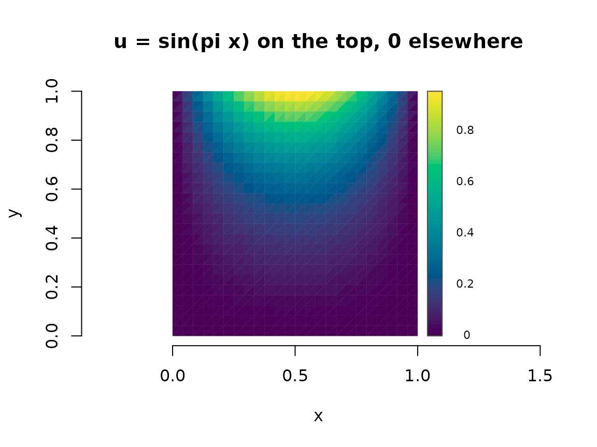
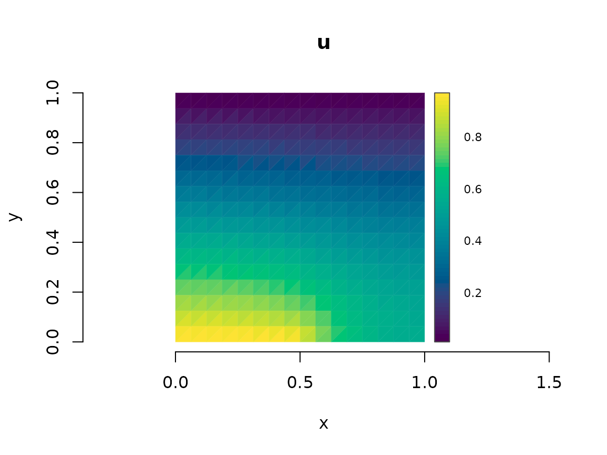

# Boundary conditions

``` r

library(pdecompR)
```

Boundary conditions are selected by **marker**. Each boundary edge has
one marker; `"boundary"` stands for all edges. Edges without a condition
get the natural condition k\\\partial u/\partial n = 0 (no flux).

| Condition | Constructor | Meaning | Enters the weak form as |
|----|----|----|----|
| Dirichlet | `dirichlet_bc(value, marker)` | u = g | eliminated degrees of freedom |
| Neumann | `neumann_bc(flux, marker)` | k\\\partial_n u = h | +\int\_{\Gamma_N} h v\\ds in L(v) |
| Robin | `robin_bc(alpha, value, marker)` | k\\\partial_n u + \alpha u = r | +\int \alpha u v\\ds in a, +\int r v\\ds in L |

Values may be numbers, `function(x, y)` or, in time-dependent problems,
`function(x, y, t)`. A function counts as time dependent when its third
argument is named `t`; other extra arguments keep their defaults. The
Robin coefficient `alpha` must not depend on time (the Robin matrix is
assembled once). Non-finite values (`NA`, `NaN`, `Inf`) are rejected.

## Dirichlet conditions

Dirichlet data are imposed by nodal interpolation at the boundary
degrees of freedom and eliminated from the system. When two conditions
share a degree of freedom (a corner), the one listed last wins.

``` r

mesh <- pde_mesh_rectangle(nx = 24)
bcs <- list(dirichlet_bc(0, "boundary"),
            dirichlet_bc(function(x, y) sin(pi * x), "top"))
s <- solve_pde(poisson_problem(mesh, source = 0, boundary = bcs))
plot(s, main = "u = sin(pi x) on the top, 0 elsewhere")
```



## Mixed Dirichlet and Neumann conditions

For u = \sin(\pi x)\sin(\pi y), the outward flux on the top edge is
\partial u/\partial y = -\pi \sin(\pi x). With Dirichlet conditions on
the other three sides the method keeps its optimal orders:

``` r

exact <- function(x, y) sin(pi * x) * sin(pi * y)
f <- function(x, y) 2 * pi^2 * exact(x, y)
prob <- poisson_problem(pde_mesh_rectangle(nx = 4), source = f,
                        boundary = list(dirichlet_bc(0, c("bottom", "left", "right")),
                                        neumann_bc(function(x, y) -pi * sin(pi * x), "top")))
convergence_study(prob, exact, mesh_sizes = c(8, 16, 32))
#> Mesh convergence study
#>        h ndof       L2 H1_semi rate_L2 rate_H1_semi
#>  0.17678   81 0.018695  0.4306      NA           NA
#>  0.08839  289 0.004776  0.2174   1.969       0.9861
#>  0.04419 1089 0.001201  0.1090   1.992       0.9965
```

Boundary integrals are evaluated with Gauss-Legendre rules on each edge
and the parent element’s basis functions, so they are correct for P1 and
P2.

## Robin conditions

Robin conditions model heat exchange with a surrounding medium. For u =
e^{x+y} on the right edge, \partial_n u = u, so \partial_n u + 2u =
3e^{x+y}:

``` r

ex <- function(x, y) exp(x + y)
prob <- elliptic_problem(pde_mesh_rectangle(nx = 4), source = function(x, y) -2 * exp(x + y),
                         bcs = list(dirichlet_bc(ex, c("bottom", "top", "left")),
                                    robin_bc(2, function(x, y) 3 * exp(x + y), "right")))
convergence_study(prob, ex, mesh_sizes = c(8, 16, 32))
#> Mesh convergence study
#>        h ndof        L2 H1_semi rate_L2 rate_H1_semi
#>  0.17678   81 0.0138553 0.36400      NA           NA
#>  0.08839  289 0.0034655 0.18220   1.999       0.9984
#>  0.04419 1089 0.0008665 0.09112   2.000       0.9996
```

## Pure Neumann problems

If no Dirichlet or Robin condition is present and there is no reaction
term, constants are in the kernel of the operator: the solution exists
only if the data are compatible,

\int\_\Omega f\\dx + \int\_{\partial\Omega} h\\ds = 0,

and then it is unique only up to a constant. pdecompR detects this case
from the assembled operator (no Dirichlet data and constants in its
kernel, which also covers `robin_bc(0, ...)` and variational problems),
checks the discrete compatibility condition through the multiplier of
the zero-mean constraint, and returns the solution with zero mean. The
result is labeled as gauged. With advection the operator is not
symmetric and the condition involves its left null vector, not \int f +
\int h; a defect larger than h^2 gives a warning and a clearly
incompatible defect (above about one percent) an error. On a mesh with
several disconnected parts each part has its own constant; this case is
not detected.

``` r

m <- pde_mesh_rectangle(nx = 24)
s <- solve_pde(poisson_problem(m, source = function(x, y) 2 * pi^2 * cos(pi * x) * cos(pi * y)))
summary(s)
#> Finite-element solution (Lagrange P1)
#>   mesh: 625 nodes, 1152 triangles, h = 0.05893
#>   degrees of freedom: 625 (625 free)
#>   matrix nonzeros: 4177
#>   solver: lu, status solved
#>   linear residual: 6.41e-12 (relative 1.63e-11)
#>   pure Neumann: zero-mean gauge, compatibility defect -1.57e-10
#>   assembly 0.005 s, solve 0.007 s
#>   solution range [-0.9937, 1.003]
#>   (the linear residual measures the algebraic solve, not the discretization error)
```

Incompatible data are an error, not an arbitrary answer:

``` r

solve_pde(poisson_problem(m, source = 1))
#> Error:
#> ! Pure Neumann problem with incompatible data: compatibility defect     1 (relative     1). The problem has no solution.
```

Balancing the source with an outflow makes the problem solvable:

``` r

s <- solve_pde(poisson_problem(m, source = 1, boundary = neumann_bc(-0.25)))
s$diagnostics$gauge$type
#> [1] "zero mean"
```

## Periodic conditions

`periodic_bc(from, to, offset)` identifies the degrees of freedom on the
boundary part `to` with those on `from`: a node at x on `to` equals the
node at \$x - \$ `offset` on `from`. The two parts must be meshed
compatibly (matching node positions), which structured meshes and
refinement guarantee; unmatched nodes are an error. The solver
eliminates the identified unknowns with a constraint matrix u = P u_r
and solves P^\top A P u_r = P^\top b.

Here the solution is periodic in x and vanishes on the bottom and top:

``` r

u <- function(x, y) cos(2 * pi * x) * sin(pi * y)
f <- function(x, y) 5 * pi^2 * u(x, y)
bc <- list(periodic_bc("left", "right", offset = c(1, 0)), dirichlet_bc(0, c("bottom", "top")))
e <- sapply(c(8, 16, 32), function(n) {
  errornorm(solve_pde(elliptic_problem(pde_mesh_rectangle(nx = n), source = f, bcs = bc)), u)
})
data.frame(n = c(8, 16, 32), L2 = e, rate = c(NA, log2(e[-3] / e[-1])))
#>    n          L2     rate
#> 1  8 0.046736961       NA
#> 2 16 0.012125241 1.946551
#> 3 32 0.003060052 1.986385
```

With periodicity in both directions there is no Dirichlet condition and
the problem is a pure Neumann problem in disguise: the data must have
zero mean and the solution is fixed by the zero-mean gauge. Corners are
identified transitively, so all four corners become one unknown.

``` r

u2 <- function(x, y) sin(2 * pi * x) * cos(2 * pi * y)
both <- list(periodic_bc("left", "right", c(1, 0)), periodic_bc("bottom", "top", c(0, 1)))
s <- solve_pde(elliptic_problem(pde_mesh_rectangle(nx = 16), source = function(x, y) 8 * pi^2 * u2(x, y),
                                bcs = both))
errornorm(s, u2)
#> [1] 0.02341302
#> attr(,"norm")
#> [1] "L2"
#> attr(,"gradient")
#> [1] "exact"
```

``` r

solve_pde(elliptic_problem(pde_mesh_rectangle(nx = 4), source = 1, bcs = both))
#> Error:
#> ! Pure Neumann problem with incompatible data: compatibility defect     1 (relative     1). The problem has no solution.
```

Periodic conditions are supported for elliptic problems. Time-dependent,
nonlinear and reaction-diffusion problems reject them with an error
instead of ignoring them.

## Markers for imported meshes

Meshes read from Gmsh carry their physical line names as markers.
Otherwise
[`set_boundary_marker()`](https://adamrsophie.github.io/pdecompR/reference/set_boundary_marker.md)
can label edges geometrically, once, after which all selection is by
marker:

``` r

m <- set_boundary_marker(pde_mesh_rectangle(nx = 16), "hot", function(x, y) y < 1e-12 & x < 0.5)
s <- solve_pde(poisson_problem(m, source = 0,
                               boundary = list(dirichlet_bc(1, "hot"), dirichlet_bc(0, "top"))))
plot(s)
```


