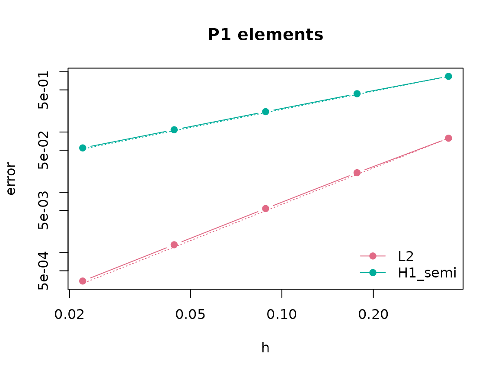

# Numerical convergence and verification

``` r

library(pdecompR)
```

A solver is only trustworthy when its errors behave as the theory
predicts. This article shows how pdecompR measures errors and how its
solvers are verified.

## Kinds of error

A computed solution differs from the true solution of a physical problem
for several distinct reasons:

- **model error**: the PDE does not describe reality exactly;
- **discretization error**: u - u_h for the exact discrete solution u_h;
- **quadrature error**: integrals in assembly are approximated;
- **algebraic error**: the linear or nonlinear solve is not exact;
- **time integration error** for evolution problems.

The solver diagnostics report the algebraic residual.
[`errornorm()`](https://adamrsophie.github.io/pdecompR/reference/errornorm.md)
measures the discretization error against a known solution, and
[`estimate_error()`](https://adamrsophie.github.io/pdecompR/reference/estimate_error.md)
estimates it when no exact solution is known.

## Error norms

\\u - u_h\\\_{L^2}^2 = \int\_\Omega (u - u_h)^2, \qquad \|u -
u_h\|\_{H^1}^2 = \int\_\Omega \|\nabla(u - u_h)\|^2, \qquad \\u -
u_h\\\_{E}^2 = \int\_\Omega k\\\|\nabla(u - u_h)\|^2 .

They are computed element by element with a quadrature rule two degrees
higher than the assembly rule. Nodal errors are a different quantity:
they can converge faster (superconvergence) and should not be mistaken
for the L^2 error.

``` r

exact <- function(x, y) sin(pi * x) * sin(pi * y)
gradient <- function(x, y) cbind(pi * cos(pi * x) * sin(pi * y), pi * sin(pi * x) * cos(pi * y))
f <- function(x, y) 2 * pi^2 * exact(x, y)
sol <- solve_pde(poisson_problem(pde_mesh_rectangle(nx = 16), source = f, boundary = dirichlet_bc(0)))
errornorm(sol, exact, "L2")
#> [1] 0.005377436
#> attr(,"norm")
#> [1] "L2"
#> attr(,"gradient")
#> [1] "exact"
errornorm(sol, exact, "H1", gradient = gradient)
#> [1] 0.2176028
#> attr(,"norm")
#> [1] "H1"
#> attr(,"gradient")
#> [1] "exact"
errornorm(sol, exact, "H1_semi")   # gradient by finite differences, labeled
#> [1] 0.2175363
#> attr(,"norm")
#> [1] "H1_semi"
#> attr(,"gradient")
#> [1] "finite difference"
```

## Convergence studies

[`convergence_study()`](https://adamrsophie.github.io/pdecompR/reference/convergence_study.md)
solves on a sequence of meshes and reports observed orders

p_i = \frac{\log(e\_{i-1}/e_i)}{\log(h\_{i-1}/h_i)} .

``` r

prob <- poisson_problem(pde_mesh_rectangle(nx = 4), source = f, boundary = dirichlet_bc(0))
p1 <- convergence_study(prob, exact, gradient, mesh_sizes = c(4, 8, 16, 32, 64))
p1
#> Mesh convergence study
#>        h ndof       L2 H1_semi rate_L2 rate_H1_semi
#>  0.35355   25 0.079077 0.83855      NA           NA
#>  0.17678   81 0.021133 0.43180   1.904       0.9575
#>  0.08839  289 0.005377 0.21754   1.974       0.9891
#>  0.04419 1089 0.001350 0.10898   1.993       0.9973
#>  0.02210 4225 0.000338 0.05451   1.998       0.9993
plot(p1, main = "P1 elements")
```



Observed orders approach 2 and 1 as h decreases. On coarse meshes the
error is not yet asymptotic, which is why tests in pdecompR accept, for
example, an observed L^2 order above 1.9 instead of demanding exactly 2.

For quadratic elements the orders are 3 and 2:

``` r

p2b <- convergence_study(poisson_problem(pde_mesh_rectangle(nx = 4), source = f,
                                         boundary = dirichlet_bc(0), degree = 2),
                         exact, gradient, mesh_sizes = c(4, 8, 16, 32))
p2b
#> Mesh convergence study
#>        h ndof        L2  H1_semi rate_L2 rate_H1_semi
#>  0.35355   81 4.328e-03 0.129389      NA           NA
#>  0.17678  289 5.481e-04 0.033387   2.981        1.954
#>  0.08839 1089 6.874e-05 0.008419   2.995        1.988
#>  0.04419 4225 8.601e-06 0.002110   2.999        1.997
```

On meshes that are not structured,
[`convergence_study()`](https://adamrsophie.github.io/pdecompR/reference/convergence_study.md)
refines uniformly:

``` r

L <- pde_mesh_polygon(rbind(c(0, 0), c(1, 0), c(1, 1), c(0.5, 0.7), c(0, 1)), h = 0.3)
ex2 <- function(x, y) exp(x) * sin(y)
cs <- convergence_study(poisson_problem(L, source = 0, boundary = dirichlet_bc(ex2)), ex2,
                        refinements = 3)
cs
#> Mesh convergence study
#>        h ndof        L2 H1_semi rate_L2 rate_H1_semi
#>  0.25000   35 4.413e-03 0.13859      NA           NA
#>  0.12500  117 1.103e-03 0.06940       2       0.9978
#>  0.06250  425 2.757e-04 0.03471       2       0.9995
#>  0.03125 1617 6.892e-05 0.01736       2       0.9999
```

## The validation suite

The package tests encode these verifications permanently:

| Problem | Check |
|----|----|
| affine solution x + 2y (P1, P2, polygon mesh) | reproduced to 10^{-12} |
| Poisson, \sin\pi x \sin\pi y, P1 | orders above 1.9 (L^2) and 0.95 (H^1) |
| Poisson, P2 | orders above 2.85 and 1.9 |
| mixed Dirichlet and Neumann | optimal orders |
| variable diffusion, Robin conditions | optimal orders |
| pure Neumann | compatibility check, zero-mean gauge, error bound |
| heat equation, P1-exact solution | temporal orders 2 (Crank-Nicolson) and 1 (backward Euler) |
| reaction-diffusion | linear decay, logistic ODE, coupled linear ODE |
| advection-diffusion | optimal orders; SUPG removes oscillations |
| quasilinear, semilinear and p-Laplace problems | optimal orders, Newton convergence |
| adaptivity on the L-shaped domain | optimal adaptive rate, beats uniform refinement |
| sensitivities | forward, adjoint and finite differences agree |

These tests use meshes of at most 32 by 32 so that `R CMD check` stays
fast.
