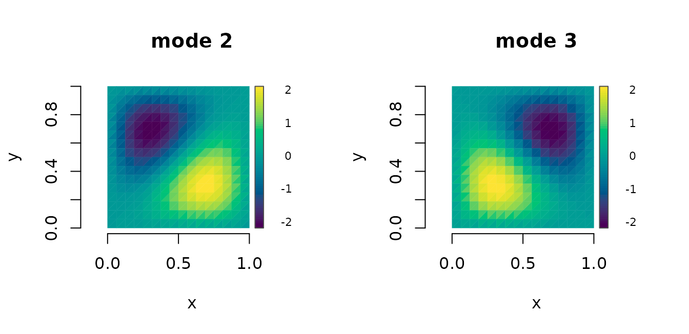

# Eigenvalue problems

``` r

library(pdecompR)
```

## Shift-and-invert subspace iteration

[`solve_eigen()`](https://adamrsophie.github.io/pdecompR/reference/solve_eigen.md)
computes eigenpairs K\mathbf x = \lambda M\mathbf x of the operator of
an
[`elliptic_problem()`](https://adamrsophie.github.io/pdecompR/reference/elliptic_problem.md)
without advection (Dirichlet conditions remove the prescribed degrees of
freedom; Neumann and Robin terms enter K) or of an
[`elasticity_problem()`](https://adamrsophie.github.io/pdecompR/reference/elasticity_problem.md)
(vibration modes). It returns the pairs nearest to a shift \sigma. One
sparse factorization of K - \sigma M is reused at every iteration, and a
Rayleigh-Ritz step on a block of n + 8 vectors extracts the
approximations. Iteration stops when every requested pair has a normwise
relative residual below `tol`.

On the unit square with Dirichlet conditions the eigenvalues are
\pi^2(j^2 + k^2):

``` r

ev <- solve_eigen(elliptic_problem(pde_mesh_rectangle(nx = 16), bcs = dirichlet_bc(0)), n = 6)
ev
#> <pde_eigen> 6 eigenpairs nearest     0 (22 iterations, largest residual 4.1e-11)
#>   values:  19.92979 50.166387 50.632876 81.971343 102.46039 102.54523
round(ev$values / pi^2, 3)
#> [1]  2.019  5.083  5.130  8.305 10.381 10.390
```

The eigenvalue error converges at order 2p for degree p:

``` r

conv <- sapply(1:2, function(deg) sapply(c(4, 8, 16), function(n) {
  p <- elliptic_problem(pde_mesh_rectangle(nx = n), bcs = dirichlet_bc(0), degree = deg)
  solve_eigen(p, n = 1)$values - 2 * pi^2
}))
colnames(conv) <- c("P1", "P2")
data.frame(n = c(4, 8, 16), conv, rate_P1 = c(NA, log2(conv[-3, 1] / conv[-1, 1])),
           rate_P2 = c(NA, log2(conv[-3, 2] / conv[-1, 2])))
#>    n        P1           P2  rate_P1  rate_P2
#> 1  4 3.1265671 0.0659098265       NA       NA
#> 2  8 0.7663361 0.0044368809 2.028530 3.892876
#> 3 16 0.1905810 0.0002831619 2.007573 3.969847
```

The modes are finite-element functions normalized to \mathbf x^\top
M\mathbf x = 1:

``` r

op <- par(mfrow = c(1, 2))
plot(ev$vectors[[2]], main = "mode 2")
plot(ev$vectors[[3]], main = "mode 3")
```



``` r

par(op)
```

Without Dirichlet conditions the operator has the eigenvalue 0 (the
constants); the default shift is then slightly negative so that K -
\sigma M stays nonsingular.

``` r

solve_eigen(elliptic_problem(pde_mesh_rectangle(nx = 16)), n = 3)$values / pi^2
#> [1] -4.183189e-17  1.003197e+00  1.003197e+00
```

## Vibration modes of an elastic body

For elasticity the mass matrix is that of unit density. A cantilever has
its bending modes first:

``` r

m <- pde_mesh_rectangle(c(0, 5), c(0, 1), nx = 20, ny = 4)
el <- elasticity_problem(m, E = 1000, nu = 0.3, bcs = displacement_bc(c(0, 0), "left"), degree = 2)
vib <- solve_eigen(el, n = 4)
sqrt(vib$values)   # angular frequencies
#> [1]  1.310250  7.018177 10.462419 16.660722
```
