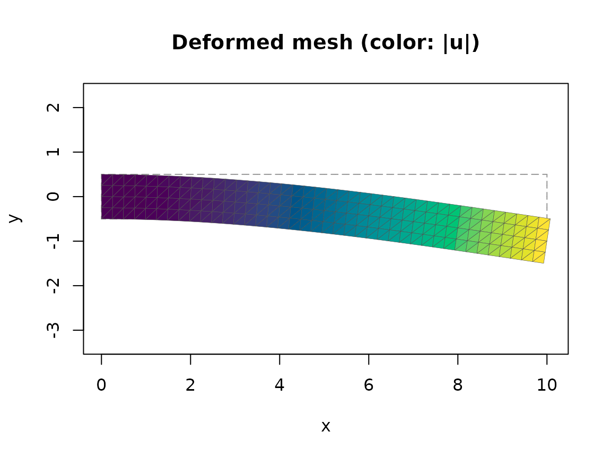

# Linear elasticity and vector-valued elements

``` r

library(pdecompR)
```

## The model

Small-strain linear elasticity seeks a displacement field u = (u_x, u_y)
with

-\nabla\cdot\sigma(u) = f, \qquad \sigma(u) = \lambda\\(\nabla\cdot
u)\\I + 2\mu\\\varepsilon(u), \qquad \varepsilon(u) = \tfrac12(\nabla
u + \nabla u^\top),

prescribed displacements on \Gamma_D and prescribed tractions \sigma(u)n
= g on \Gamma_N. Edges without a condition are traction free. The weak
form is

\int\_\Omega \sigma(u):\varepsilon(v)\\dx = \int\_\Omega f\cdot v\\dx +
\int\_{\Gamma_N} g\cdot v\\ds .

The Lamé parameters come from Young’s modulus E and Poisson’s ratio \nu:
\mu = E/(2(1+\nu)), and \lambda = E\nu/((1+\nu)(1-2\nu)) in plane strain
or \lambda = E\nu/(1-\nu^2) in plane stress.

## Vector-valued spaces

The displacement lives in a vector-valued Lagrange space: each component
is a scalar P1 or P2 function, and the unknowns are ordered with all x
components first. For basis functions \phi_j e_a (trial) and \phi_i e_b
(test) the element matrix is

\int_T \lambda\\\partial_a\phi_j\\\partial_b\phi_i +
\mu\left(\delta\_{ab}\\\nabla\phi_j\cdot\nabla\phi_i +
\partial_b\phi_j\\\partial_a\phi_i\right) dx,

assembled with the same vectorized tensor kernel as anisotropic
diffusion. The global matrix is symmetric, and positive definite once
the displacement conditions remove the three rigid motions.

## A cantilever beam

A beam of length 10 and height 1 is clamped on the left and loaded by a
downward traction on the right end:

``` r

mesh <- pde_mesh_rectangle(c(0, 10), c(-0.5, 0.5), nx = 40, ny = 4)
beam <- function(degree) {
  elasticity_problem(mesh, E = 1000, nu = 0.3, plane = "stress", degree = degree,
                     bcs = list(displacement_bc(c(0, 0), "left"),
                                traction_bc(c(0, -1), "right")))
}
s2 <- solve_pde(beam(2))
s2
#> <pde_vector_solution> P2 displacement, 1458 dofs (1440 free); solver cholesky (solved), relative residual 1.12e-10
#>   max |u| = 4.033
plot(s2)
```



Timoshenko beam theory predicts the tip deflection PL^3/(3EI) +
PL/(\kappa GA) with I = 1/12, G = E/(2(1+\nu)) and \kappa = 5/6:

``` r

theory <- 10^3 / (3 * 1000 / 12) + 10 / (5 / 6 * 1000 / 2.6)
s1 <- solve_pde(beam(1))
c(theory = theory, P1 = -evaluate(s1$uy, 10, 0), P2 = -evaluate(s2$uy, 10, 0))
#>   theory       P1       P2 
#> 4.031200 3.307235 4.021759
```

Quadratic elements agree with beam theory to within a few tenths of a
percent. Linear triangles are much too stiff in bending (*shear
locking*): on this mesh with four elements across the height, they give
only about 82 percent of the deflection. Refining helps slowly; P2
elements are the practical remedy.

## Rollers and partial constraints

`displacement_bc(..., components = "x")` fixes one component only. A bar
in uniaxial tension, with rollers on the left and bottom edges, has the
exact solution u_x = \sigma x/E, u_y = -\nu\sigma y/E, which the method
reproduces to rounding error:

``` r

bar <- elasticity_problem(pde_mesh_rectangle(nx = 4), E = 2, nu = 0.25, plane = "stress",
                          bcs = list(displacement_bc(0, "left", components = "x"),
                                     displacement_bc(0, "bottom", components = "y"),
                                     traction_bc(c(1, 0), "right")))
sb <- solve_pde(bar)
xy <- sb$space$dof_coords
max(abs(sb$ux$values - xy[, 1] / 2), abs(sb$uy$values + 0.25 * xy[, 2] / 2))
#> [1] 1.110223e-15
```

Without enough constraints the problem has no unique solution, and the
solver says so:

``` r

solve_pde(elasticity_problem(pde_mesh_rectangle(nx = 4), bcs = traction_bc(c(1, 0), "right")))
#> Error:
#> ! The elasticity system is singular or nearly singular: the displacement conditions must remove the rigid motions (two translations and a rotation).
```

## Verification with a manufactured solution

For u = (\sin\pi x\sin\pi y,\\ xy(1-x)(1-y)) with \lambda = 1.5, \mu =
1, the body force is f = -\mu\Delta u - (\lambda+\mu)\nabla(\nabla\cdot
u).
[`errornorm()`](https://adamrsophie.github.io/pdecompR/reference/errornorm.md)
and
[`convergence_study()`](https://adamrsophie.github.io/pdecompR/reference/convergence_study.md)
accept vector solutions: the exact solution returns two columns, and the
gradient is a list with one gradient function per component.

``` r

lam <- 1.5; mu <- 1
E <- mu * (3 * lam + 2 * mu) / (lam + mu); nu <- lam / (2 * (lam + mu))
exact <- function(x, y) cbind(sin(pi * x) * sin(pi * y), x * y * (1 - x) * (1 - y))
gradient <- list(function(x, y) cbind(pi * cos(pi * x) * sin(pi * y), pi * sin(pi * x) * cos(pi * y)),
                 function(x, y) cbind(y * (1 - y) * (1 - 2 * x), x * (1 - x) * (1 - 2 * y)))
force <- function(x, y) {
  uxx <- -pi^2 * sin(pi * x) * sin(pi * y); uxy <- pi^2 * cos(pi * x) * cos(pi * y)
  vxx <- -2 * y * (1 - y); vyy <- -2 * x * (1 - x); vxy <- (1 - 2 * x) * (1 - 2 * y)
  cbind(-(mu * 2 * uxx + (lam + mu) * (uxx + vxy)),
        -(mu * (vxx + vyy) + (lam + mu) * (uxy + vyy)))
}
for (degree in 1:2) {
  p <- elasticity_problem(pde_mesh_rectangle(nx = 4), E = E, nu = nu, body_force = force,
                          bcs = displacement_bc(c(0, 0)), degree = degree)
  print(convergence_study(p, exact, gradient, mesh_sizes = c(8, 16, 32)))
}
#> Mesh convergence study
#>        h ndof       L2 H1_semi rate_L2 rate_H1_semi
#>  0.17678  162 0.022277  0.4345      NA           NA
#>  0.08839  578 0.005809  0.2183   1.939       0.9930
#>  0.04419 2178 0.001470  0.1093   1.982       0.9985
#> Mesh convergence study
#>        h ndof        L2  H1_semi rate_L2 rate_H1_semi
#>  0.17678  578 5.590e-04 0.033664      NA           NA
#>  0.08839 2178 6.926e-05 0.008452   3.013        1.994
#>  0.04419 8450 8.629e-06 0.002115   3.005        1.999
```

The observed orders are 2 and 1 for P1, and 3 and 2 for P2, as for
scalar problems.

## Limitations

- Nearly incompressible materials (\nu \to 1/2 in plane strain) lock
  with these displacement elements; mixed displacement-pressure
  formulations are on the roadmap.
- Only small strains and isotropic materials are supported; E and \nu
  may vary in space.
