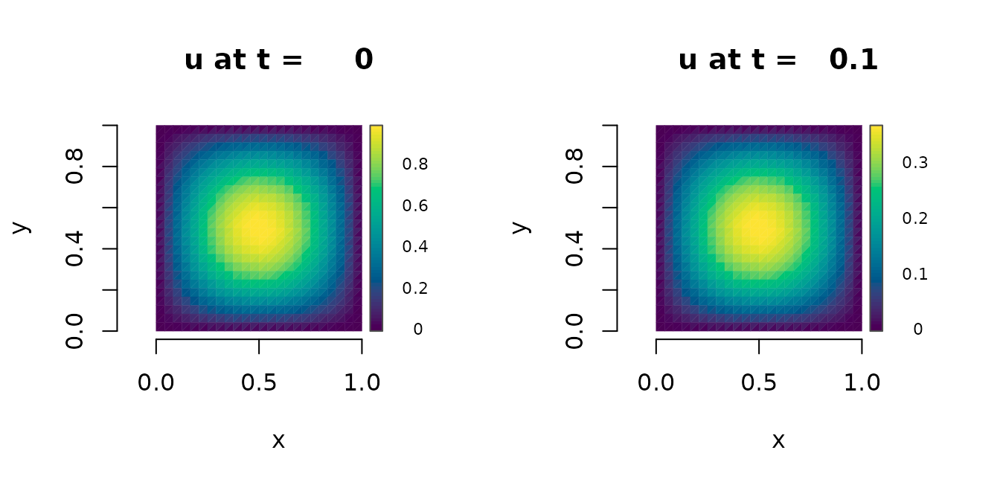
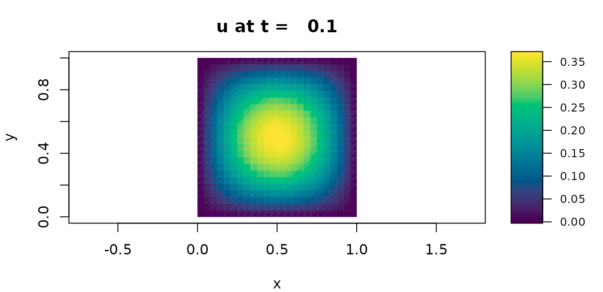
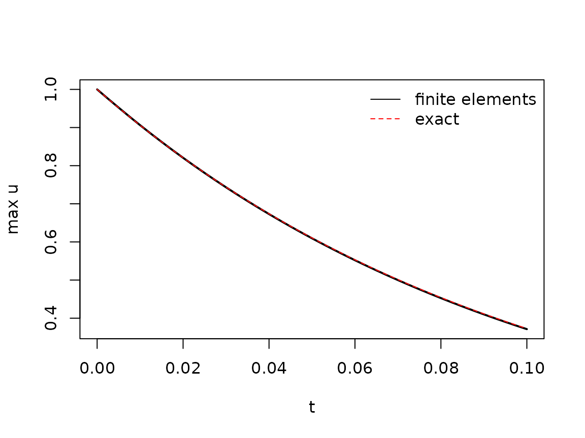
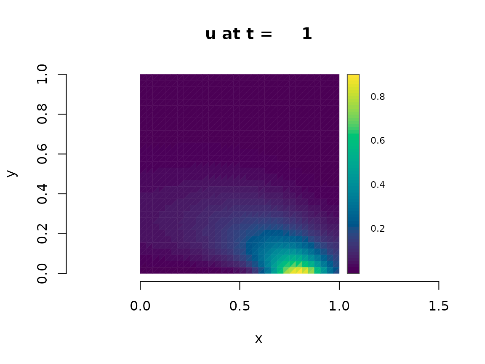

# The heat equation and parabolic problems

``` r

library(pdecompR)
```

## Semidiscretization

For

\partial_t u - \nabla\cdot(\kappa\nabla u) = f(x, t), \qquad u(\cdot, 0)
= u_0,

the finite-element method in space gives the system of ordinary
differential equations

M \frac{d\mathbf U}{dt} + K\mathbf U = \mathbf F(t),

with mass matrix M\_{ij} = \int\phi_j\phi_i and stiffness matrix K. Both
are assembled once.

## Time stepping

The theta method with step \Delta t reads

(M + \theta\Delta t K)\mathbf U^{n+1} = (M - (1 - \theta)\Delta t
K)\mathbf U^n + \Delta t\left(\theta \mathbf F^{n+1} + (1 -
\theta)\mathbf F^n\right).

- \theta = 1, **backward Euler**: first order, L-stable, damps all
  modes.
- \theta = 1/2, **Crank-Nicolson**: second order, A-stable but only
  weakly damping; very rough initial data can produce slowly decaying
  oscillations.

The matrix M + \theta\Delta t K is factored once (Cholesky) and reused
at every step. Dirichlet data g(x, t) are imposed at each new time
level.

## Decay of a Fourier mode

With u_0 = \sin(\pi x)\sin(\pi y), zero boundary values and no source,
the exact solution is e^{-2\pi^2\kappa t}u_0.

``` r

kappa <- 0.5
u0 <- function(x, y) sin(pi * x) * sin(pi * y)
prob <- heat_problem(pde_mesh_rectangle(nx = 24), diffusivity = kappa, initial = u0,
                     bcs = dirichlet_bc(0), time = c(0, 0.1))
sol <- solve_pde(prob, dt = 0.0025)
sol
#> <pde_transient> P1, 625 dofs, 40 steps of crank-nicolson (dt = 0.0025)
#>   stored times: 41 in [    0,   0.1]
summary(sol)
#> Time-dependent finite-element solution
#>   method: crank-nicolson  dt: 0.0025  steps: 40 
#>   degrees of freedom: 625  ( 529  free)
#>   linear solver: cholesky  max relative residual: 5.4e-16 
#>   assembly 0.019 s, time stepping 0.013 s

exact_end <- function(x, y) exp(-2 * pi^2 * kappa * 0.1) * u0(x, y)
errornorm(solution_at(sol, 0.1), exact_end, "L2")
#> [1] 0.001401432
#> attr(,"norm")
#> [1] "L2"
#> attr(,"gradient")
#> [1] "exact"
```

``` r

op <- par(mfrow = c(1, 2))
plot(sol, time = 0)
```



``` r

plot(sol, time = 0.1)
```



``` r

par(op)
```

The solution amplitude follows the exact decay:

``` r

peak <- apply(sol$values, 2, max)
plot(sol$times, peak, type = "l", xlab = "t", ylab = "max u", lwd = 2)
curve(exp(-2 * pi^2 * kappa * x), add = TRUE, lty = 2, col = "red")
legend("topright", c("finite elements", "exact"), lty = 1:2, col = c("black", "red"), bty = "n")
```



## Temporal convergence in isolation

To measure the time error alone, use a solution that the spatial
discretization represents exactly: u = e^{-t}(x + 2y) is linear in
space, so the semidiscrete solution is exact and any remaining error
comes from time stepping.

``` r

ex <- function(x, y, t) exp(-t) * (x + 2 * y)
p <- heat_problem(pde_mesh_rectangle(nx = 4), source = function(x, y, t) -exp(-t) * (x + 2 * y),
                  initial = function(x, y) x + 2 * y, bcs = dirichlet_bc(ex), time = c(0, 1))
dts <- c(0.1, 0.05, 0.025, 0.0125)
err <- sapply(c("backward-euler", "crank-nicolson"), function(m) sapply(dts, function(dt) {
  s <- solve_pde(p, dt = dt, method = m, output_times = 1)
  max(abs(s$values[, 1] - ex(s$space$dof_coords[, 1], s$space$dof_coords[, 2], 1)))
}))
data.frame(dt = dts, err, rate_BE = c(NA, diff(log(err[, 1])) / diff(log(dts))),
           rate_CN = c(NA, diff(log(err[, 2])) / diff(log(dts))))
#>       dt backward.euler crank.nicolson  rate_BE  rate_CN
#> 1 0.1000   0.0021116021   3.446611e-05       NA       NA
#> 2 0.0500   0.0010367972   8.482943e-06 1.026204 2.022542
#> 3 0.0250   0.0005137428   2.121328e-06 1.013015 1.999597
#> 4 0.0125   0.0002557196   5.303579e-07 1.006483 1.999930
```

## Time-dependent sources and boundary data

Sources and boundary values can depend on time. Here a hot spot moves
along the bottom boundary while the top is kept cold:

``` r

hot <- function(x, y, t) exp(-50 * (x - 0.2 - 0.6 * t)^2)
p <- heat_problem(pde_mesh_rectangle(nx = 32), diffusivity = 0.05, initial = 0,
                  bcs = list(dirichlet_bc(hot, "bottom"), dirichlet_bc(0, "top")), time = c(0, 1))
s <- solve_pde(p, dt = 0.025, output_times = c(0.25, 0.5, 1))
plot(s, time = 1)
```



## Conservation and stability

With zero-flux boundaries and no source, the total heat \int u\\dx =
\mathbf 1^\top M \mathbf U is conserved exactly by both schemes, because
\mathbf 1^\top K = 0:

``` r

p <- heat_problem(pde_mesh_rectangle(nx = 16), initial = function(x, y) exp(-30 * ((x - 0.3)^2 + y^2)),
                  time = c(0, 0.5))
s <- solve_pde(p, dt = 0.05, method = "backward-euler")
w <- assemble_vector(s$space, 1)
range(colSums(w * s$values))
#> [1] 0.05179147 0.05179147
```

## General parabolic problems

[`parabolic_problem()`](https://adamrsophie.github.io/pdecompR/reference/parabolic_problem.md)
adds advection and reaction, \partial_t u - \nabla\cdot(k\nabla u) +
b\cdot\nabla u + cu = f, with optional SUPG stabilization (consistent:
the time derivative is included in the stabilized residual). See the
advection-diffusion article.
