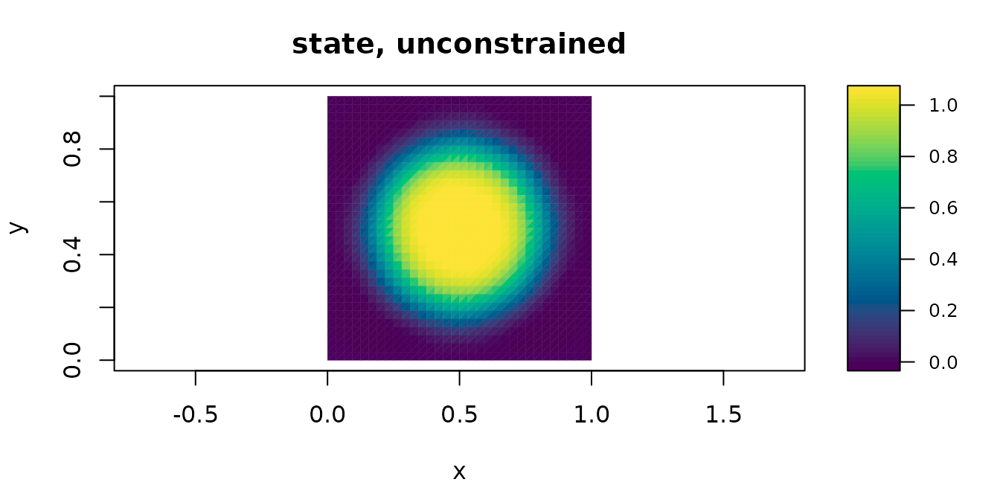

# Sensitivities, inverse problems and optimal control

``` r

library(pdecompR)
```

## Sensitivities of the discrete system

After Dirichlet elimination a parameterized linear problem is
K(\theta)\mathbf u(\theta) = \mathbf r(\theta). If K is invertible and
the data are differentiable,

K\frac{\partial\mathbf u}{\partial\theta_j} = \frac{\partial\mathbf
r}{\partial\theta_j} - \frac{\partial K}{\partial\theta_j}\mathbf u .

This **forward sensitivity** costs one solve per parameter with the
already factored K. For a scalar objective J(\mathbf u), the **discrete
adjoint** solves K^\top\lambda = \partial J/\partial\mathbf u once and
gives

\frac{dJ}{d\theta_j} = \lambda^\top\left(\frac{\partial\mathbf
r}{\partial\theta_j} - \frac{\partial K}{\partial\theta_j}\mathbf
u\right),

independent of the number of parameters. Both are *discrete*
derivatives: they are the exact derivatives of the discrete model, which
differ from derivatives of the continuous model by discretization error.
The operator derivatives \partial K/\partial\theta_j and \partial\mathbf
r/\partial\theta_j are formed by central differences of the assembled
operators, which is exact up to rounding when the coefficients are
affine in \theta.

A problem is parameterized by a function returning an elliptic problem:

``` r

mesh <- pde_mesh_rectangle(nx = 16)
pf <- function(theta) poisson_problem(mesh, diffusion = theta[1], source = 1,
                                      boundary = dirichlet_bc(0))
s <- pde_sensitivity(pf, theta = 2)
# the exact derivative: u = u_1 / theta, so du/dtheta = -u / theta
max(abs(s$sensitivities[, 1] + s$solution$u$values / 2))
#> [1] 1.510524e-12
```

With several parameters, forward, adjoint and finite-difference
gradients agree:

``` r

pf2 <- function(theta) elliptic_problem(mesh, diffusion = function(x, y) theta[1] + theta[2] * x,
                                        reaction = theta[3], source = 1, bcs = dirichlet_bc(0))
obs <- pde_observations(c(0.3, 0.6, 0.5), c(0.4, 0.5, 0.8), c(0.05, 0.1, 0.02), sd = 0.1)
J <- misfit_objective(fe_space(mesh), obs)
th <- c(1, 0.5, 0.3)
fwd <- pde_sensitivity(pf2, th, objective = J, method = "forward")$gradient
adj <- pde_sensitivity(pf2, th, objective = J, method = "adjoint")$gradient
fd <- sapply(1:3, function(j) {
  e <- replace(numeric(3), j, 1e-5)
  (J(solve_pde(pf2(th + e))$u$values)$value - J(solve_pde(pf2(th - e))$u$values)$value) / 2e-5
})
rbind(forward = fwd, adjoint = adj, finite_difference = fd)
#>                        [,1]       [,2]        [,3]
#> forward           0.1264122 0.07538522 0.007326827
#> adjoint           0.1264122 0.07538522 0.007326827
#> finite_difference 0.1264122 0.07538522 0.007326827
```

## Parameter estimation

Given point measurements y_i with standard deviations \sigma_i,
[`estimate_parameters()`](https://adamrsophie.github.io/pdecompR/reference/estimate_parameters.md)
minimizes

\frac12\sum_i\left(\frac{u_h(x_i;\theta) - y_i}{\sigma_i}\right)^2 +
\frac\lambda2\\\theta - \theta\_{\text{ref}}\\^2

with L-BFGS-B (bounds allowed) and adjoint gradients. Forward solves are
cached so the objective and gradient at the same \theta share one solve.

Here we identify a diffusion coefficient k(x, y) = \theta_1 + \theta_2 x
from 25 noisy observations of a solution computed on a finer mesh, which
avoids the “inverse crime” of generating data with the same
discretization:

``` r

pf3 <- function(theta, mesh) elliptic_problem(mesh, diffusion = function(x, y) theta[1] + theta[2] * x,
                                              source = 1, bcs = dirichlet_bc(0))
truth <- c(0.5, 1.5)
fine <- solve_pde(pf3(truth, pde_mesh_rectangle(nx = 64)))
set.seed(1)
xo <- runif(25, 0.1, 0.9); yo <- runif(25, 0.1, 0.9)
sd_obs <- 2e-4
obs <- pde_observations(xo, yo, evaluate(fine$u, xo, yo) + rnorm(25, sd = sd_obs), sd = sd_obs)

est <- estimate_parameters(pf3, theta0 = c(1, 1), observations = obs,
                           mesh = pde_mesh_rectangle(nx = 16), lower = c(0.01, 0))
est
#> PDE parameter estimate (L-BFGS-B, convergence code 0)
#>   estimate std_error
#> 1  0.48965 0.0025551
#> 2  1.50242 0.0072236
#>   objective 7.105, gradient norm 2.24e-05, forward solves 13
#>   standard errors: measurement noise only (Gauss-Newton linearization)
#>   identifiability: sensitivity condition number 9.21
#>   discretization check: predictions change by up to 0.000883 (4.415 sd) on a refined mesh
```

The report keeps two sources of uncertainty apart:

- the **standard errors** come from the Gauss-Newton approximation
  (S^\top WS + \lambda I)^{-1} and reflect measurement noise only;
- the **discretization check** re-solves the model at the estimate on a
  uniformly refined mesh and reports how much the predicted observations
  change. If that change is comparable to the noise level, the mesh is
  too coarse for the data and the estimate is biased by discretization
  error.

## Distributed optimal control

[`optimal_control()`](https://adamrsophie.github.io/pdecompR/reference/optimal_control.md)
solves

\min_q\\ \frac12\\u - u\_{\text{target}}\\\_{L^2}^2 +
\frac\alpha2\\q\\\_{L^2}^2 \quad\text{subject to}\quad
-\nabla\cdot(k\nabla u) = f + q,

with the control q in the P1 space. The problem is strictly convex.
Without bounds, the optimality (KKT) system

\begin{pmatrix} M & 0 & -K^\top \\ 0 & \alpha M & M^\top \\ K & -M & 0
\end{pmatrix} \begin{pmatrix} \mathbf u \\ \mathbf q \\ \lambda
\end{pmatrix} = \cdots

is solved directly; with bounds the reduced problem is solved with
L-BFGS-B and adjoint gradients.

``` r

target <- function(x, y) as.numeric((x - 0.5)^2 + (y - 0.5)^2 < 0.1)
oc <- optimal_control(pde_mesh_rectangle(nx = 32), target, alpha = 1e-5)
oc
#> Distributed optimal control (KKT (sparse LU))
#>   objective 0.0157022, projected gradient norm 6.96e-18
#>   control range [-43.3, 65.48]
ocb <- optimal_control(pde_mesh_rectangle(nx = 32), target, alpha = 1e-5, lower = 0, upper = 50)
ocb
#> Distributed optimal control (reduced L-BFGS-B (adjoint gradient))
#>   objective 0.0260844, projected gradient norm 1.89e-08
#>   control range [    0, 42.75]
```

``` r

op <- par(mfrow = c(1, 2))
plot(oc$state, main = "state, unconstrained")
plot(ocb$control, main = "control, 0 <= q <= 50")
```



``` r

par(op)
```

The discontinuous target cannot be reached exactly; the regularization
\alpha trades tracking accuracy against control effort. For nonconvex
problems (for example, coefficient identification with many parameters)
a local optimizer finds a local minimum; no global optimality is
claimed.

## Outlook

Adjoints for nonlinear and time-dependent problems, shape derivatives,
and an interface to the optimization package optcompR are planned.
