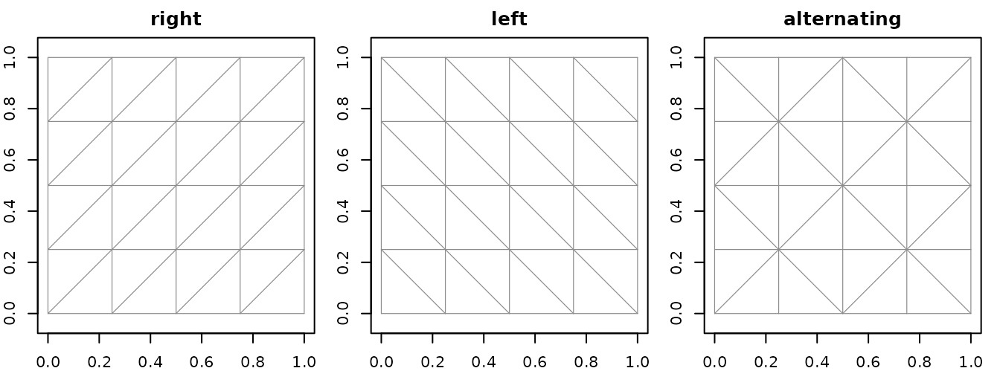

# Domains and meshes

``` r

library(pdecompR)
```

The mesh is the foundation of every finite-element computation. pdecompR
represents two-dimensional triangular meshes with explicit topology and
named boundary regions, and it validates every mesh it builds.

## Domains

A domain is a pure geometric description. Rectangles have four named
sides; polygons name each side individually.

``` r

pde_domain("rectangle", x = c(0, 2), y = c(0, 1))
#> <pde_domain> rectangle 
#>   (0, 2) x (0, 1)
#>   markers: bottom, right, top, left

L <- rbind(c(0, 0), c(2, 0), c(2, 1), c(1, 1), c(1, 2), c(0, 2))
dom <- pde_domain("polygon", vertices = L,
                  markers = c("bottom", "right", "step", "step", "top", "left"))
dom
#> <pde_domain> polygon 
#>   vertices: 6 
#>   markers: bottom, right, step, top, left
```

Validation rejects degenerate geometry: repeated vertices, zero-length
sides, zero area and self-intersecting boundaries. Clockwise polygons
are reordered (their markers follow) and a message says so.

``` r

pde_domain("polygon", vertices = rbind(c(0, 0), c(1, 1), c(1, 0), c(0, 1)))
#> Error:
#> ! Polygon boundary intersects itself.
```

## Structured meshes

[`pde_mesh_rectangle()`](https://adamrsophie.github.io/pdecompR/reference/pde_mesh_rectangle.md)
generates structured meshes with three diagonal patterns. Corner nodes
belong to both adjacent sides.

``` r

op <- par(mfrow = c(1, 3), mar = c(2, 2, 2, 1))
for (p in c("right", "left", "alternating")) {
  plot(pde_mesh_rectangle(nx = 4, pattern = p), main = p, markers = FALSE)
}
```



``` r

par(op)
```

## The mesh object

A `pde_mesh` stores

- `nodes`: an n \times 2 matrix of coordinates;
- `triangles`: an m \times 3 integer matrix, counterclockwise;
- `edges`: the unique edges, and `element_edges` mapping each triangle’s
  local edges (v_1, v_2), (v_2, v_3), (v_3, v_1) to global edges;
- `edge_elements`: the one or two triangles sharing each edge;
- `boundary`: a data frame of boundary edges with nodes `n1`, `n2`
  (oriented with the domain on the left), the global edge, the parent
  element, the local edge and the marker.

``` r

mesh <- pde_mesh_rectangle(nx = 2)
head(mesh$triangles)
#>      [,1] [,2] [,3]
#> [1,]    1    2    5
#> [2,]    2    3    6
#> [3,]    4    5    8
#> [4,]    5    6    9
#> [5,]    1    5    4
#> [6,]    2    6    5
mesh$boundary
#>   n1 n2 edge element local marker
#> 1  1  2    1       1     1 bottom
#> 2  2  3    2       2     1 bottom
#> 3  3  6   10       2     2  right
#> 4  6  9   12       4     2  right
#> 5  8  7   13       7     2    top
#> 6  9  8   14       8     2    top
#> 7  4  1   15       5     3   left
#> 8  7  4   16       7     3   left
```

## Validation

[`pde_mesh()`](https://adamrsophie.github.io/pdecompR/reference/pde_mesh.md)
builds a mesh from raw coordinates and connectivity and checks it
thoroughly. It rejects invalid node indices, repeated nodes in an
element, duplicate elements, zero-area triangles, unused nodes, edges
shared by more than two triangles, overlapping elements, and boundary
definitions that do not match the topological boundary. Clockwise
elements are an error unless reorientation is requested explicitly.

``` r

P <- rbind(c(0, 0), c(1, 0), c(1, 1), c(0, 1))
pde_mesh(P, rbind(c(1, 3, 2), c(1, 3, 4)))
#> Error:
#> ! 1 element(s) are clockwise (first: 1). Use `fix_orientation = TRUE` to reorder them.
m <- pde_mesh(P, rbind(c(1, 3, 2), c(1, 3, 4)), fix_orientation = TRUE)
m$info$reoriented
#> [1] 1
pde_mesh(rbind(c(0, 0), c(1, 0), c(2, 0)), rbind(c(1, 2, 3)))
#> Error:
#> ! Element 1 has zero area (degenerate triangle).
```

Boundary markers can be supplied as an explicit list of boundary edges;
every topological boundary edge must appear exactly once.

``` r

be <- rbind(c(1, 2), c(2, 3), c(3, 4), c(4, 1))
m <- pde_mesh(P, rbind(c(1, 2, 3), c(1, 3, 4)), be, c("inflow", "wall", "outflow", "wall"))
table(m$boundary$marker)
#> 
#>  inflow outflow    wall 
#>       1       1       2
```

## Geometry and quality

[`mesh_quality()`](https://adamrsophie.github.io/pdecompR/reference/mesh_quality.md)
returns, per element, the area, longest and shortest edges, minimum and
maximum angles and the shape ratio 2r/R (inradius over circumradius; 1
for equilateral triangles).

``` r

summary(pde_mesh_rectangle(nx = 8))
#> Triangular mesh summary
#>   nodes 81  elements 128  edges 208  boundary edges 32 
#>   total area         1 
#>   edge length: min 0.125  max 0.1768 
#>   angles (deg): min    45  max    90 
#>   shape ratio 2r/R: min 0.8284  median 0.8284  max 0.8284 
#>   boundary edges by marker:
#>     bottom: 8
#>     left: 8
#>     right: 8
#>     top: 8
head(mesh_quality(pde_mesh_rectangle(nx = 8)))
#>        area     h_max h_min min_angle max_angle shape_ratio
#> 1 0.0078125 0.1767767 0.125        45        90   0.8284271
#> 2 0.0078125 0.1767767 0.125        45        90   0.8284271
#> 3 0.0078125 0.1767767 0.125        45        90   0.8284271
#> 4 0.0078125 0.1767767 0.125        45        90   0.8284271
#> 5 0.0078125 0.1767767 0.125        45        90   0.8284271
#> 6 0.0078125 0.1767767 0.125        45        90   0.8284271
```

## Polygonal domains

[`pde_mesh_polygon()`](https://adamrsophie.github.io/pdecompR/reference/pde_mesh_polygon.md)
triangulates a simple polygon by ear clipping, flips edges until the
coarse triangulation is Delaunay, and refines uniformly until the
longest edge is at most `h`. Side markers are kept.

``` r

mL <- pde_mesh_polygon(dom, h = 0.25)
summary(mL)
#> Triangular mesh summary
#>   nodes 153  elements 256  edges 408  boundary edges 48 
#>   total area         3 
#>   edge length: min 0.125  max  0.25 
#>   angles (deg): min    45  max    90 
#>   shape ratio 2r/R: min 0.8284  median 0.8284  max 0.8284 
#>   boundary edges by marker:
#>     bottom: 8
#>     left: 8
#>     right: 8
#>     step: 16
#>     top: 8
plot(mL, main = "L-shaped domain")
```


This mesher has no external dependencies but does not guarantee element
quality for arbitrary polygons. For complex geometry, generate a mesh
with [Gmsh](https://gmsh.info) and read it with
[`read_gmsh()`](https://adamrsophie.github.io/pdecompR/reference/read_gmsh.md);
physical line groups become boundary markers.

``` r

f <- system.file("extdata", "square.msh", package = "pdecompR")
gm <- read_gmsh(f)
#> Ignored 1 element(s) that are not triangles or lines.
table(gm$boundary$marker)
#> 
#> bottom   left  right    top 
#>      2      2      2      2
```

[`write_vtk()`](https://adamrsophie.github.io/pdecompR/reference/write_vtk.md)
exports meshes and solutions to the VTK format for ParaView.

## Refinement

[`refine_uniform()`](https://adamrsophie.github.io/pdecompR/reference/refine_uniform.md)
splits each triangle into four similar triangles.
[`refine_mesh()`](https://adamrsophie.github.io/pdecompR/reference/refine_uniform.md)
refines selected elements by newest vertex bisection and keeps the mesh
conforming: no hanging nodes appear, and the minimum angle stays
bounded.

``` r

m <- pde_mesh_rectangle(nx = 4)
for (k in 1:5) {
  P <- m$nodes; T <- m$triangles
  cx <- (P[T[, 1], 1] + P[T[, 2], 1] + P[T[, 3], 1]) / 3
  cy <- (P[T[, 1], 2] + P[T[, 2], 2] + P[T[, 3], 2]) / 3
  m <- refine_mesh(m, which(sqrt((cx - 0.5)^2 + (cy - 0.5)^2) < 0.15))
}
plot(m, main = "Local refinement around (0.5, 0.5)")
```


``` r

min(mesh_quality(m)$min_angle)
#> [1] 45
```

Refined meshes record the parent edge of every new node in
`info$new_nodes`, so P1 functions transfer exactly from coarse to fine
meshes
([`transfer_function()`](https://adamrsophie.github.io/pdecompR/reference/transfer_function.md)).

## Selecting boundary parts

[`boundary_nodes()`](https://adamrsophie.github.io/pdecompR/reference/boundary_markers.md)
and
[`boundary_dofs()`](https://adamrsophie.github.io/pdecompR/reference/boundary_dofs.md)
select nodes by marker. For imported meshes without physical groups,
[`set_boundary_marker()`](https://adamrsophie.github.io/pdecompR/reference/set_boundary_marker.md)
relabels boundary edges whose midpoints satisfy a predicate.

``` r

m <- set_boundary_marker(pde_mesh_rectangle(nx = 8), "inlet",
                         function(x, y) x < 1e-12 & y > 0.25 & y < 0.75)
table(m$boundary$marker)
#> 
#> bottom  inlet   left  right    top 
#>      8      4      4      8      8
```
