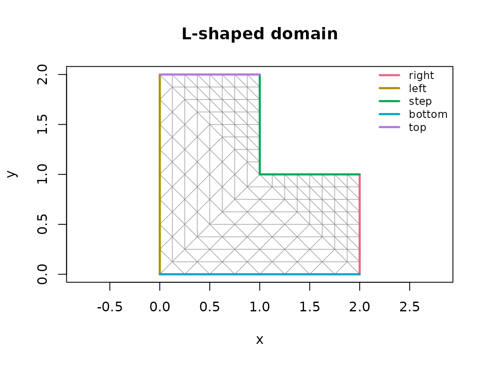
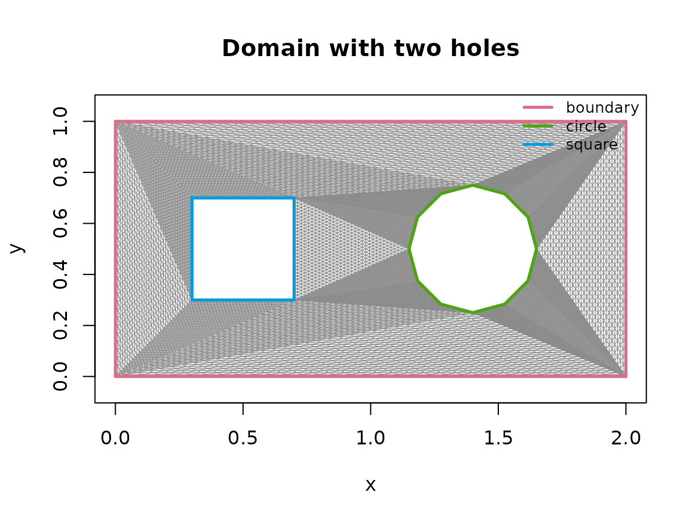
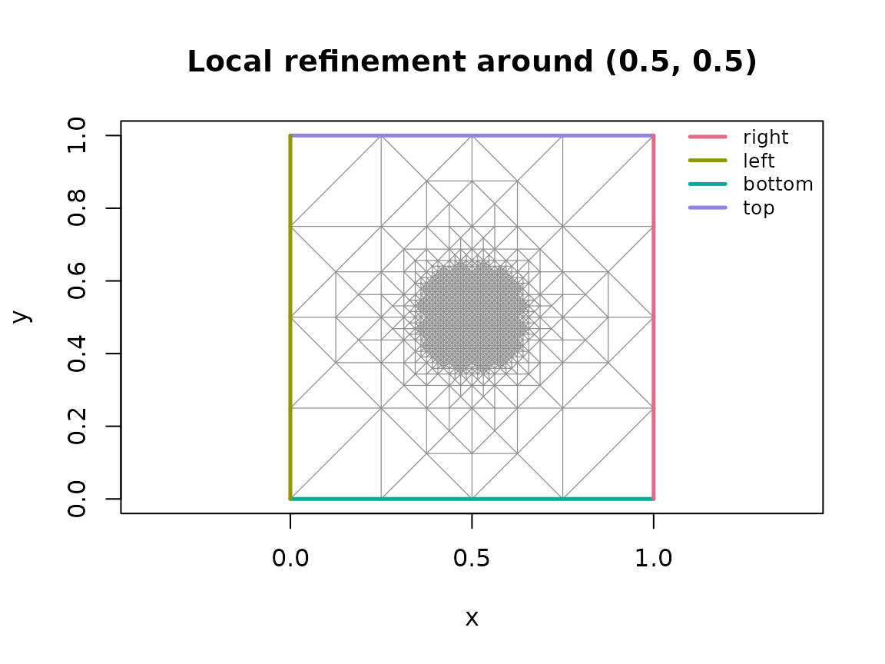

# Domains and meshes

``` r

library(pdecompR)
```

The mesh is the foundation of every finite-element computation. pdecompR
represents two-dimensional triangular meshes with explicit topology and
named boundary regions, and it validates every mesh it builds.

## Domains

A domain is a pure geometric description. Rectangles have four named
sides; polygons name each side individually.

``` r

pde_domain("rectangle", x = c(0, 2), y = c(0, 1))
#> <pde_domain> rectangle 
#>   (0, 2) x (0, 1)
#>   markers: bottom, right, top, left

L <- rbind(c(0, 0), c(2, 0), c(2, 1), c(1, 1), c(1, 2), c(0, 2))
dom <- pde_domain("polygon", vertices = L,
                  markers = c("bottom", "right", "step", "step", "top", "left"))
dom
#> <pde_domain> polygon 
#>   vertices: 6 
#>   markers: bottom, right, step, top, left
```

Validation rejects degenerate geometry: repeated vertices, zero-length
sides, zero area and self-intersecting boundaries. Clockwise polygons
are reordered (their markers follow) and a message says so.

``` r

pde_domain("polygon", vertices = rbind(c(0, 0), c(1, 1), c(1, 0), c(0, 1)))
#> Error:
#> ! Polygon boundary intersects itself.
```

## Structured meshes

[`pde_mesh_rectangle()`](https://adamrsophie.github.io/pdecompR/reference/pde_mesh_rectangle.md)
generates structured meshes with three diagonal patterns. Corner nodes
belong to both adjacent sides.

``` r

op <- par(mfrow = c(1, 3), mar = c(2, 2, 2, 1))
for (p in c("right", "left", "alternating")) {
  plot(pde_mesh_rectangle(nx = 4, pattern = p), main = p, markers = FALSE)
}
```


``` r

par(op)
```

## The mesh object

A `pde_mesh` stores

- `nodes`: an n \times 2 matrix of coordinates;
- `triangles`: an m \times 3 integer matrix, counterclockwise;
- `edges`: the unique edges, and `element_edges` mapping each triangle’s
  local edges (v_1, v_2), (v_2, v_3), (v_3, v_1) to global edges;
- `edge_elements`: the one or two triangles sharing each edge;
- `boundary`: a data frame of boundary edges with nodes `n1`, `n2`
  (oriented with the domain on the left), the global edge, the parent
  element, the local edge and the marker.

``` r

mesh <- pde_mesh_rectangle(nx = 2)
head(mesh$triangles)
#>      [,1] [,2] [,3]
#> [1,]    1    2    5
#> [2,]    2    3    6
#> [3,]    4    5    8
#> [4,]    5    6    9
#> [5,]    1    5    4
#> [6,]    2    6    5
mesh$boundary
#>   n1 n2 edge element local marker
#> 1  1  2    1       1     1 bottom
#> 2  2  3    2       2     1 bottom
#> 3  3  6   10       2     2  right
#> 4  6  9   12       4     2  right
#> 5  8  7   13       7     2    top
#> 6  9  8   14       8     2    top
#> 7  4  1   15       5     3   left
#> 8  7  4   16       7     3   left
```

## Validation

[`pde_mesh()`](https://adamrsophie.github.io/pdecompR/reference/pde_mesh.md)
builds a mesh from raw coordinates and connectivity and checks it
thoroughly. It rejects invalid node indices, repeated nodes in an
element, duplicate elements, zero-area triangles, unused nodes, edges
shared by more than two triangles, neighboring elements that overlap
across a shared edge, boundary definitions that do not match the
topological boundary, and elements that overlap without sharing an edge.
The last check uses two facts about a valid triangulation: the corner
angles around an interior node sum to 2\pi (at most 2\pi at a boundary
node), and boundary edges without a common node never touch. Clockwise
elements are an error unless reorientation is requested explicitly.

``` r

P <- rbind(c(0, 0), c(1, 0), c(1, 1), c(0, 1))
pde_mesh(P, rbind(c(1, 3, 2), c(1, 3, 4)))
#> Error:
#> ! 1 element(s) are clockwise (first: 1). Use `fix_orientation = TRUE` to reorder them.
m <- pde_mesh(P, rbind(c(1, 3, 2), c(1, 3, 4)), fix_orientation = TRUE)
m$info$reoriented
#> [1] 1
pde_mesh(rbind(c(0, 0), c(1, 0), c(2, 0)), rbind(c(1, 2, 3)))
#> Error:
#> ! Element 1 has zero area (degenerate triangle).
# two squares with their own nodes, overlapping in a quarter
P2 <- rbind(P, P + 0.5)
pde_mesh(P2, rbind(c(1, 2, 3), c(1, 3, 4), c(5, 6, 7), c(5, 7, 8)))
#> Error:
#> ! Boundary edges (3, 4) and (8, 5) intersect: elements overlap.
```

Boundary markers can be supplied as an explicit list of boundary edges;
every topological boundary edge must appear exactly once.

``` r

be <- rbind(c(1, 2), c(2, 3), c(3, 4), c(4, 1))
m <- pde_mesh(P, rbind(c(1, 2, 3), c(1, 3, 4)), be, c("inflow", "wall", "outflow", "wall"))
table(m$boundary$marker)
#> 
#>  inflow outflow    wall 
#>       1       1       2
```

## Geometry and quality

[`mesh_quality()`](https://adamrsophie.github.io/pdecompR/reference/mesh_quality.md)
returns, per element, the area, longest and shortest edges, minimum and
maximum angles and the shape ratio 2r/R (inradius over circumradius; 1
for equilateral triangles).

``` r

summary(pde_mesh_rectangle(nx = 8))
#> Triangular mesh summary
#>   nodes 81  elements 128  edges 208  boundary edges 32 
#>   total area         1 
#>   edge length: min 0.125  max 0.1768 
#>   angles (deg): min    45  max    90 
#>   shape ratio 2r/R: min 0.8284  median 0.8284  max 0.8284 
#>   boundary edges by marker:
#>     bottom: 8
#>     left: 8
#>     right: 8
#>     top: 8
head(mesh_quality(pde_mesh_rectangle(nx = 8)))
#>        area     h_max h_min min_angle max_angle shape_ratio
#> 1 0.0078125 0.1767767 0.125        45        90   0.8284271
#> 2 0.0078125 0.1767767 0.125        45        90   0.8284271
#> 3 0.0078125 0.1767767 0.125        45        90   0.8284271
#> 4 0.0078125 0.1767767 0.125        45        90   0.8284271
#> 5 0.0078125 0.1767767 0.125        45        90   0.8284271
#> 6 0.0078125 0.1767767 0.125        45        90   0.8284271
```

## Polygonal domains

[`pde_mesh_polygon()`](https://adamrsophie.github.io/pdecompR/reference/pde_mesh_polygon.md)
triangulates a simple polygon by ear clipping, flips edges until the
coarse triangulation is Delaunay, and refines uniformly until the
longest edge is at most `h`. Side markers are kept.

``` r

mL <- pde_mesh_polygon(dom, h = 0.25)
summary(mL)
#> Triangular mesh summary
#>   nodes 153  elements 256  edges 408  boundary edges 48 
#>   total area         3 
#>   edge length: min 0.125  max  0.25 
#>   angles (deg): min    45  max    90 
#>   shape ratio 2r/R: min 0.8284  median 0.8284  max 0.8284 
#>   boundary edges by marker:
#>     bottom: 8
#>     left: 8
#>     right: 8
#>     step: 16
#>     top: 8
plot(mL, main = "L-shaped domain")
```



Polygons may have holes. Each hole is a simple polygon strictly inside
the outer one, and its sides get their own marker (`"hole"` by default).
The mesher connects every hole to the outer boundary by a bridge segment
and triangulates the resulting single polygon, so no external mesher is
needed.

``` r

sq <- rbind(c(0, 0), c(2, 0), c(2, 1), c(0, 1))
holes <- list(rbind(c(0.3, 0.3), c(0.7, 0.3), c(0.7, 0.7), c(0.3, 0.7)),
              cbind(1.4 + 0.25 * cos(seq(0, 2 * pi, length.out = 13)[-13]),
                    0.5 + 0.25 * sin(seq(0, 2 * pi, length.out = 13)[-13])))
dh <- pde_domain("polygon", vertices = sq, holes = holes, hole_markers = c("square", "circle"))
mh <- pde_mesh_polygon(dh, h = 0.1)
table(mh$boundary$marker)
#> 
#> boundary   circle   square 
#>      128      384      128
plot(mh, main = "Domain with two holes")
```



Holes that leave the outer polygon, overlap each other or touch a
boundary are rejected when the domain is created.

This mesher has no external dependencies but does not guarantee element
quality for arbitrary polygons. For complex geometry, generate a mesh
with [Gmsh](https://gmsh.info) and read it with
[`read_gmsh()`](https://adamrsophie.github.io/pdecompR/reference/read_gmsh.md);
physical line groups become boundary markers.

``` r

f <- system.file("extdata", "square.msh", package = "pdecompR")
gm <- read_gmsh(f)
#> Ignored 1 element(s) that are not triangles or lines.
table(gm$boundary$marker)
#> 
#> bottom   left  right    top 
#>      2      2      2      2
```

[`write_vtk()`](https://adamrsophie.github.io/pdecompR/reference/write_vtk.md)
exports meshes and solutions to the VTK format for ParaView: the legacy
format by default, the XML `.vtu` format when the file name ends in
`.vtu` (raw binary by default, exact to the last bit; `format = "ascii"`
for text).
[`write_pvd()`](https://adamrsophie.github.io/pdecompR/reference/write_pvd.md)
writes a time-dependent solution as one `.vtu` file per output time plus
a `.pvd` collection that ParaView opens as an animation.

## Refinement

[`refine_uniform()`](https://adamrsophie.github.io/pdecompR/reference/refine_uniform.md)
splits each triangle into four similar triangles.
[`refine_mesh()`](https://adamrsophie.github.io/pdecompR/reference/refine_uniform.md)
refines selected elements by newest vertex bisection and keeps the mesh
conforming: no hanging nodes appear, and the minimum angle stays
bounded.

``` r

m <- pde_mesh_rectangle(nx = 4)
for (k in 1:5) {
  P <- m$nodes; T <- m$triangles
  cx <- (P[T[, 1], 1] + P[T[, 2], 1] + P[T[, 3], 1]) / 3
  cy <- (P[T[, 1], 2] + P[T[, 2], 2] + P[T[, 3], 2]) / 3
  m <- refine_mesh(m, which(sqrt((cx - 0.5)^2 + (cy - 0.5)^2) < 0.15))
}
plot(m, main = "Local refinement around (0.5, 0.5)")
```



``` r

min(mesh_quality(m)$min_angle)
#> [1] 45
```

[`transfer_function()`](https://adamrsophie.github.io/pdecompR/reference/transfer_function.md)
moves a function to another mesh by evaluating it at the new degrees of
freedom. Refined meshes are nested in their parents, so P1 and P2
functions transfer exactly from coarse to fine meshes. Refined meshes
also record the parent edge of every new node in `info$new_nodes`.

### Curved boundaries

Refining a polygon keeps its chords, so on a disk the error stalls at
the geometric error of the coarse polygon.
[`curved_boundary()`](https://adamrsophie.github.io/pdecompR/reference/curved_boundary.md)
attaches the closest point projection of the curve to a boundary marker;
refinement then puts new boundary nodes on the curve and the domain
converges with the mesh. For -\Delta u = 4 on the unit disk with u = 1 -
r^2:

``` r

n <- 12
circle <- cbind(cos(2 * pi * (1:n) / n), sin(2 * pi * (1:n) / n))
m0 <- pde_mesh_polygon(circle)
mc <- curved_boundary(m0, "boundary", function(x, y) cbind(x, y) / sqrt(x^2 + y^2))
exact <- function(x, y) 1 - x^2 - y^2
err <- function(m) errornorm(solve_pde(poisson_problem(m, source = 4, boundary = dirichlet_bc(0))),
                             exact, "L2")
e <- sapply(list(straight = m0, curved = mc), function(m) {
  sapply(1:4, function(k) { for (i in seq_len(k)) m <- refine_uniform(m); err(m) })
})
e
#>        straight      curved
#> [1,] 0.33647807 0.268536112
#> [2,] 0.15125121 0.067776297
#> [3,] 0.10136100 0.016976434
#> [4,] 0.08755111 0.004245441
log2(e[-4, ] / e[-1, ])
#>       straight   curved
#> [1,] 1.1535658 1.986263
#> [2,] 0.5774439 1.997247
#> [3,] 0.2113053 1.999547
```

The curved sequence keeps the P1 rate 2. Elements stay straight sided,
so P2 edge nodes sit on chords and P2 converges only as fast as the
polygonal domain (rate 2 in L2, 1.5 in H1); isoparametric elements are
not provided. Refined curved meshes cover slightly different domains, so
compare them with exact functions rather than with solutions on other
meshes of the sequence.

## Selecting boundary parts

[`boundary_nodes()`](https://adamrsophie.github.io/pdecompR/reference/boundary_markers.md)
and
[`boundary_dofs()`](https://adamrsophie.github.io/pdecompR/reference/boundary_dofs.md)
select nodes by marker. For imported meshes without physical groups,
[`set_boundary_marker()`](https://adamrsophie.github.io/pdecompR/reference/set_boundary_marker.md)
relabels boundary edges whose midpoints satisfy a predicate.

``` r

m <- set_boundary_marker(pde_mesh_rectangle(nx = 8), "inlet",
                         function(x, y) x < 1e-12 & y > 0.25 & y < 0.75)
table(m$boundary$marker)
#> 
#> bottom  inlet   left  right    top 
#>      8      4      4      8      8
```
