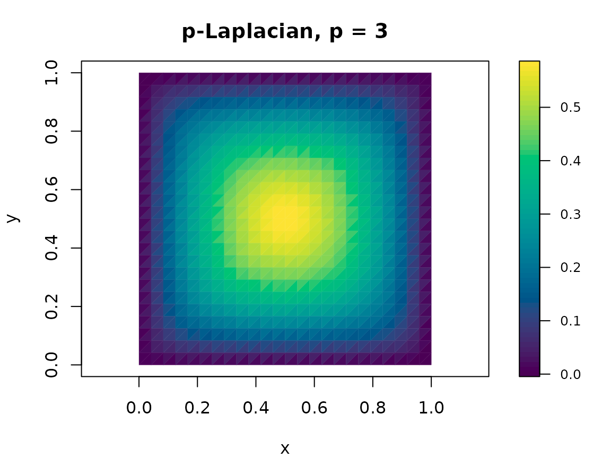

# Nonlinear problems and Newton's method

``` r

library(pdecompR)
```

## Residual form

[`nonlinear_problem()`](https://adamrsophie.github.io/pdecompR/reference/nonlinear_problem.md)
covers quasilinear diffusion with a semilinear reaction,

-\nabla\cdot(k(u)\nabla u) + g(u) = f,

and
[`p_laplace_problem()`](https://adamrsophie.github.io/pdecompR/reference/nonlinear_problem.md)
the regularized p-Laplacian -\nabla\cdot((\|\nabla u\|^2 +
\varepsilon^2)^{(p-2)/2}\nabla u) = f. The discrete residual is

F_i(\mathbf U) = \int k(u_h)\nabla u_h\cdot\nabla\phi_i + g(u_h)\phi_i -
f\phi_i\\dx - (\text{boundary terms}),

and Newton’s method solves J(\mathbf U_k)\\\delta = -F(\mathbf U_k),
\mathbf U\_{k+1} = \mathbf U_k + \lambda\delta, with the consistent
Jacobian

J\_{ij} = \int k(u_h)\nabla\phi_j\cdot\nabla\phi_i +
k'(u_h)\phi_j\\\nabla u_h\cdot\nabla\phi_i + g'(u_h)\phi_j\phi_i\\dx .

The step length \lambda is halved until the residual norm decreases
(backtracking line search). The derivatives k' and g' can be supplied;
otherwise they are approximated by central differences.

## A manufactured quasilinear problem

With k(u) = 1 + u^2 and u = \sin\pi x\sin\pi y, the source is f =
k(u)\\2\pi^2u - 2u\|\nabla u\|^2.

``` r

exact <- function(x, y) sin(pi * x) * sin(pi * y)
gradient <- function(x, y) cbind(pi * cos(pi * x) * sin(pi * y), pi * sin(pi * x) * cos(pi * y))
k <- function(u) 1 + u^2
f <- function(x, y) {
  u <- exact(x, y); g <- gradient(x, y)
  k(u) * 2 * pi^2 * u - 2 * u * (g[, 1]^2 + g[, 2]^2)
}
prob <- nonlinear_problem(pde_mesh_rectangle(nx = 16), diffusion = k,
                          diffusion_derivative = function(u) 2 * u,
                          source = f, bcs = dirichlet_bc(0))
sol <- solve_pde(prob)
sol$newton
#>   iteration     residual step
#> 1         0 7.850530e-01   NA
#> 2         1 1.213728e-01    1
#> 3         2 3.421530e-03    1
#> 4         3 2.188875e-06    1
#> 5         4 6.670955e-13    1
```

The residual history shows quadratic convergence: the number of correct
digits roughly doubles in each step. The discretization error behaves as
in the linear case:

``` r

convergence_study(prob, exact, gradient, mesh_sizes = c(8, 16, 32))
#> Mesh convergence study
#>        h ndof       L2 H1_semi rate_L2 rate_H1_semi
#>  0.17678   81 0.018275  0.4324      NA           NA
#>  0.08839  289 0.004644  0.2176   1.976       0.9906
#>  0.04419 1089 0.001166  0.1090   1.994       0.9977
```

## Semilinear reaction

``` r

f2 <- function(x, y) 2 * pi^2 * exact(x, y) + exact(x, y)^3
p2 <- nonlinear_problem(pde_mesh_rectangle(nx = 16), reaction = function(u) u^3,
                        reaction_derivative = function(u) 3 * u^2, source = f2, bcs = dirichlet_bc(0))
s2 <- solve_pde(p2)
errornorm(s2, exact, "L2")
#> [1] 0.005049698
#> attr(,"norm")
#> [1] "L2"
#> attr(,"gradient")
#> [1] "exact"
```

## The p-Laplacian

For p = 3 the diffusivity grows with the gradient. The regularization
\varepsilon \> 0 keeps the Jacobian nonsingular where \nabla u = 0; the
Jacobian contains the tensor k I + (p - 2)(\|\nabla u\|^2 +
\varepsilon^2)^{(p-4)/2}\nabla u\nabla u^\top.

``` r

pl <- p_laplace_problem(pde_mesh_rectangle(nx = 24), p = 3, source = 10, bcs = dirichlet_bc(0))
spl <- solve_pde(pl)
spl$newton
#>   iteration     residual step
#> 1         0 8.511676e-01   NA
#> 2         1 1.500854e-01    1
#> 3         2 1.036201e-02    1
#> 4         3 1.372507e-04    1
#> 5         4 2.366676e-07    1
#> 6         5 7.762651e-13    1
lin <- solve_pde(poisson_problem(pl$mesh, source = 10, boundary = dirichlet_bc(0)))
c(p_laplace = max(spl$u$values), laplace = max(lin$u$values))
#> p_laplace   laplace 
#> 0.5898417 0.7357080
plot(spl, main = "p-Laplacian, p = 3")
```



## When Newton fails

Newton’s method converges only from a good enough initial guess.
pdecompR starts from the solution of the linearized problem, uses a line
search, and reports failure instead of returning an unconverged iterate
silently:

``` r

hard <- nonlinear_problem(pde_mesh_rectangle(nx = 8), diffusion = function(u) 1 + u^2,
                          source = 50, bcs = dirichlet_bc(0))
res <- tryCatch(solve_pde(hard, maxit = 1), warning = function(w) conditionMessage(w))
res
#> [1] "Newton did not converge in 1 iterations (residual 6.954, initial 25.15)."
```

With enough iterations the same problem converges:

``` r

solve_pde(hard)$newton
#>   iteration     residual step
#> 1         0 2.514537e+01   NA
#> 2         1 6.954222e+00    1
#> 3         2 1.334002e+00    1
#> 4         3 8.674478e-02    1
#> 5         4 3.783451e-04    1
#> 6         5 6.510843e-09    1
#> 7         6 4.818931e-15    1
```
