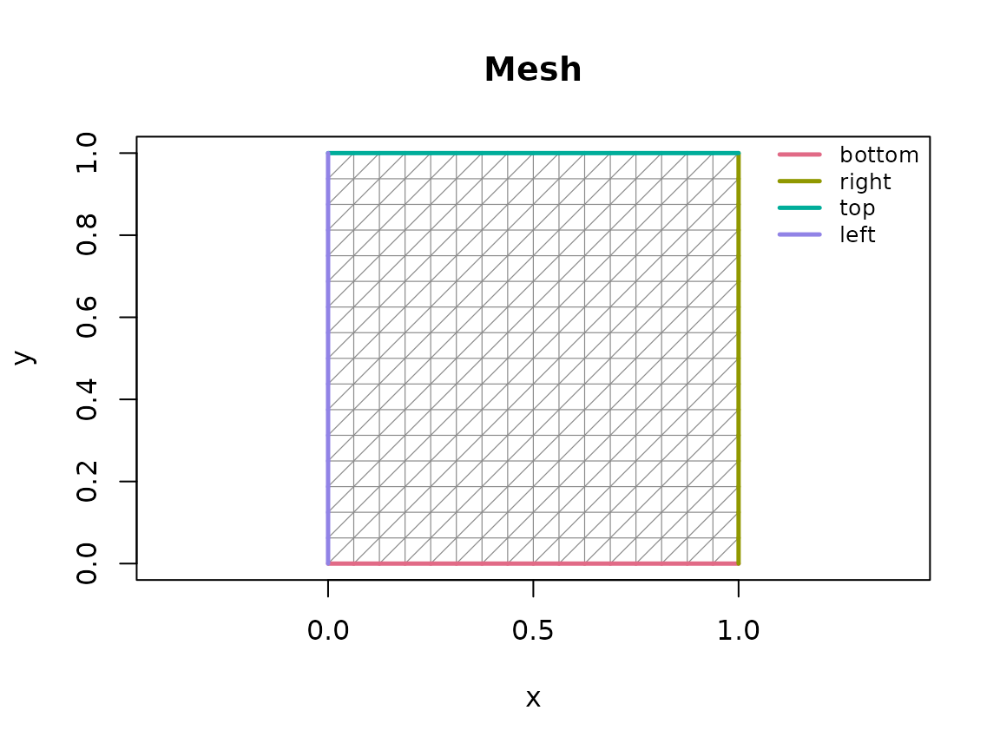
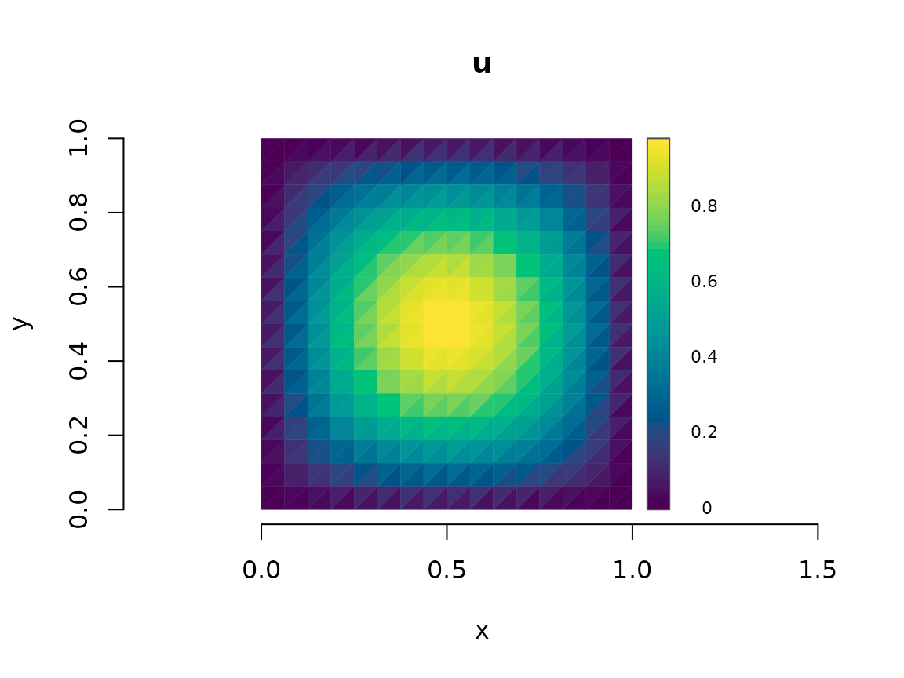
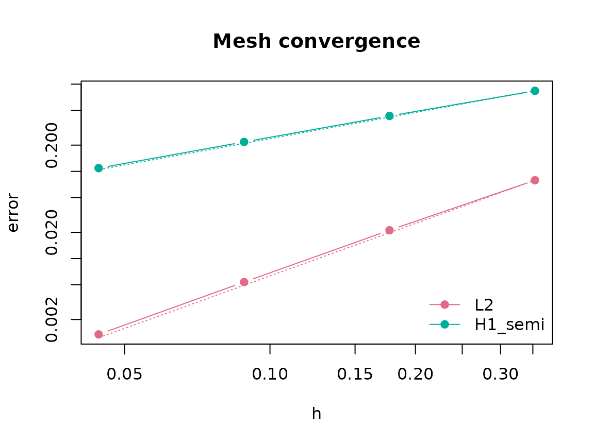

# Introduction to pdecompR

pdecompR solves partial differential equations (PDEs) with the
finite-element method, entirely in R. This article walks through the
whole pipeline once, from a geometric domain to a verified numerical
solution. The other articles go deeper into each step.

``` r

library(pdecompR)
```

## From a PDE to a linear system

Consider the Poisson problem on the unit square \Omega = (0, 1)^2:

-\nabla \cdot (k \nabla u) = f \quad \text{in } \Omega, \qquad u = 0
\quad \text{on } \partial\Omega .

Multiplying by a test function v that vanishes on the boundary and
integrating by parts gives the **weak formulation**: find u \in
H^1_0(\Omega) such that

a(u, v) = \int\_\Omega k \nabla u \cdot \nabla v \\ dx = \int\_\Omega f
v \\ dx = L(v) \quad \text{for all } v \in H^1_0(\Omega).

The weak form needs only first derivatives, so piecewise polynomials
that are continuous across element boundaries are admissible. The
finite-element method replaces H^1_0(\Omega) by a finite-dimensional
space V_h spanned by basis functions \phi_1, \dots, \phi_N. Writing u_h
= \sum_j U_j \phi_j and testing with every \phi_i gives the linear
system

K \mathbf U = \mathbf F, \qquad K\_{ij} = \int\_\Omega k \nabla \phi_j
\cdot \nabla \phi_i \\ dx, \qquad F_i = \int\_\Omega f \phi_i \\ dx .

Each basis function is nonzero only on a few elements, so K is sparse.
If k \> 0 the matrix restricted to the interior degrees of freedom is
symmetric positive definite, and a sparse Cholesky factorization solves
it.

## The pipeline in code

**Geometry and mesh.**
[`pde_mesh_rectangle()`](https://adamrsophie.github.io/pdecompR/reference/pde_mesh_rectangle.md)
splits the square into n_x \times n_y cells and each cell into two
triangles. Boundary edges carry markers (`"bottom"`, `"right"`, `"top"`,
`"left"`), and `"boundary"` selects all of them.

``` r

mesh <- pde_mesh_rectangle(x = c(0, 1), y = c(0, 1), nx = 16, ny = 16)
mesh
#> <pde_mesh> 2D triangular mesh
#>   nodes: 289  elements: 512  edges: 800  boundary edges: 64 
#>   h = 0.08839 
#>   markers: bottom, right, top, left
plot(mesh)
```



**Problem definition.** A problem object stores the mathematical
definition (coefficients, source, boundary conditions) and nothing
numerical:

``` r

f <- function(x, y) 2 * pi^2 * sin(pi * x) * sin(pi * y)
problem <- poisson_problem(mesh, diffusion = 1, source = f,
                           boundary = dirichlet_bc(value = 0, marker = "boundary"))
problem
#> <elliptic_problem> on a mesh with 512 triangles, P1
#>   dirichlet on boundary
```

**Discretization and solution.**
[`solve_pde()`](https://adamrsophie.github.io/pdecompR/reference/solve_pde.md)
builds the P1 space, assembles K and \mathbf F, eliminates the Dirichlet
degrees of freedom and solves the sparse system:

``` r

solution <- solve_pde(problem)
summary(solution)
#> Finite-element solution (Lagrange P1)
#>   mesh: 289 nodes, 512 triangles, h = 0.08839
#>   degrees of freedom: 289 (225 free)
#>   matrix nonzeros: 1889
#>   solver: cholesky, status solved
#>   linear residual: 3.7e-15 (relative 6.04e-15)
#>   assembly 0.007 s, solve 0.028 s
#>   solution range [    0, 0.9968]
#>   (the linear residual measures the algebraic solve, not the discretization error)
plot(solution)
```



The summary separates the *algebraic* residual of the linear solve from
the *discretization* error. A tiny residual only says that K \mathbf U =
\mathbf F was solved accurately.

**Verification.** For this source the exact solution is u = \sin(\pi
x)\sin(\pi y), so the discretization error can be measured:

``` r

exact <- function(x, y) sin(pi * x) * sin(pi * y)
errornorm(solution, exact, "L2")
#> [1] 0.005377436
#> attr(,"norm")
#> [1] "L2"
#> attr(,"gradient")
#> [1] "exact"
errornorm(solution, exact, "H1_semi")
#> [1] 0.2175363
#> attr(,"norm")
#> [1] "H1_semi"
#> attr(,"gradient")
#> [1] "finite difference"
```

and a refinement study shows the expected orders, 2 in L^2 and 1 in H^1
for linear elements:

``` r

study <- convergence_study(problem, exact, mesh_sizes = c(4, 8, 16, 32))
study
#> Mesh convergence study
#>        h ndof       L2 H1_semi rate_L2 rate_H1_semi
#>  0.35355   25 0.079077  0.8385      NA           NA
#>  0.17678   81 0.021133  0.4318   1.904       0.9575
#>  0.08839  289 0.005377  0.2175   1.974       0.9891
#>  0.04419 1089 0.001350  0.1090   1.993       0.9973
plot(study)
```



## Objects and conventions

| Object | Created by | Meaning |
|----|----|----|
| `pde_domain` | [`pde_domain()`](https://adamrsophie.github.io/pdecompR/reference/pde_domain.md) | geometry: rectangle or polygon with side markers |
| `pde_mesh` | [`pde_mesh_rectangle()`](https://adamrsophie.github.io/pdecompR/reference/pde_mesh_rectangle.md), [`pde_mesh_polygon()`](https://adamrsophie.github.io/pdecompR/reference/pde_mesh_polygon.md), [`pde_mesh()`](https://adamrsophie.github.io/pdecompR/reference/pde_mesh.md), [`read_gmsh()`](https://adamrsophie.github.io/pdecompR/reference/read_gmsh.md) | nodes, triangles, edges, boundary edges with markers |
| `fe_element` | [`fe_element()`](https://adamrsophie.github.io/pdecompR/reference/fe_element.md) | reference Lagrange element |
| `fe_space` | [`fe_space()`](https://adamrsophie.github.io/pdecompR/reference/fe_space.md) | global degrees of freedom on a mesh |
| `fe_function` | [`fe_function()`](https://adamrsophie.github.io/pdecompR/reference/fe_function.md), [`interpolate()`](https://adamrsophie.github.io/pdecompR/reference/fe_function.md) | coefficient vector in a space |
| `pde_bc` | [`dirichlet_bc()`](https://adamrsophie.github.io/pdecompR/reference/dirichlet_bc.md), [`neumann_bc()`](https://adamrsophie.github.io/pdecompR/reference/dirichlet_bc.md), [`robin_bc()`](https://adamrsophie.github.io/pdecompR/reference/dirichlet_bc.md) | boundary conditions selected by marker |
| `pde_problem` | [`poisson_problem()`](https://adamrsophie.github.io/pdecompR/reference/elliptic_problem.md), [`elliptic_problem()`](https://adamrsophie.github.io/pdecompR/reference/elliptic_problem.md), [`heat_problem()`](https://adamrsophie.github.io/pdecompR/reference/parabolic_problem.md), … | mathematical problem |
| `pde_discretization` | [`discretize()`](https://adamrsophie.github.io/pdecompR/reference/discretize.md) | assembled system before elimination |
| `pde_solution` | [`solve_pde()`](https://adamrsophie.github.io/pdecompR/reference/solve_pde.md) | solution with `pde_diagnostics` |

All indices are one-based. Triangles are counterclockwise, boundary
edges are oriented with the domain on their left, and boundary
conditions are selected by marker, never by comparing floating-point
coordinates.

## Where to go next

- *Meshes* explains domains, validation, quality and refinement.
- *Finite elements* covers basis functions, quadrature and spaces.
- *Poisson*, *Boundary conditions*, *Assembly* and *Convergence* treat
  elliptic problems in depth; *Weak forms* shows the form language.
- *Heat*, *Reaction-diffusion*, *Advection-diffusion* and *Nonlinear*
  cover time-dependent and nonlinear problems.
- *Adaptivity* and *Inverse problems* cover error estimation, adaptive
  refinement, sensitivities, parameter estimation and optimal control.
