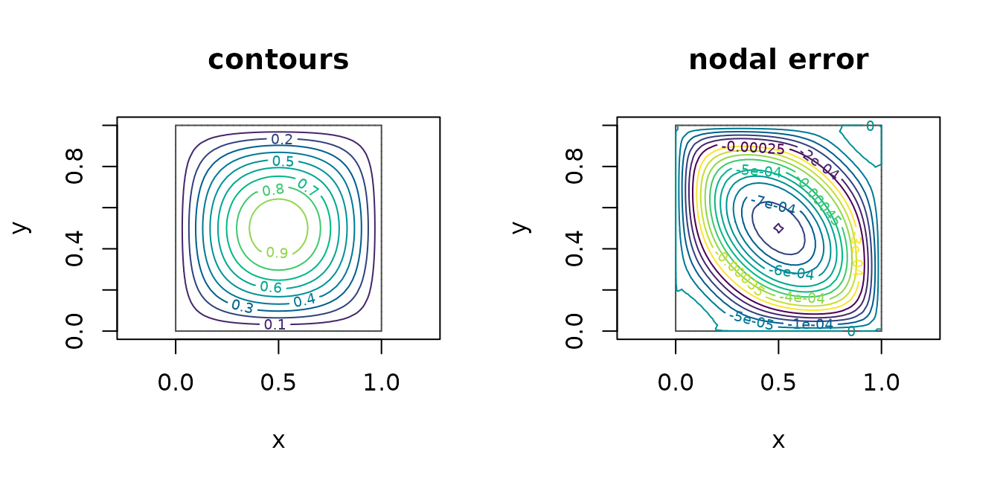
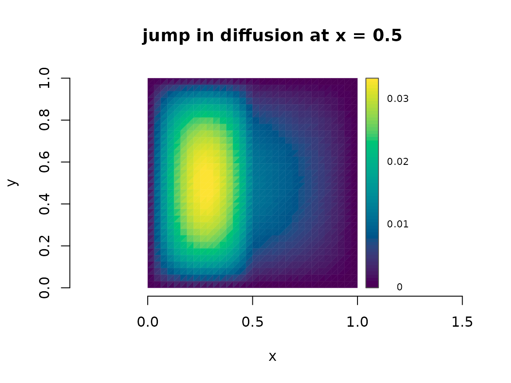
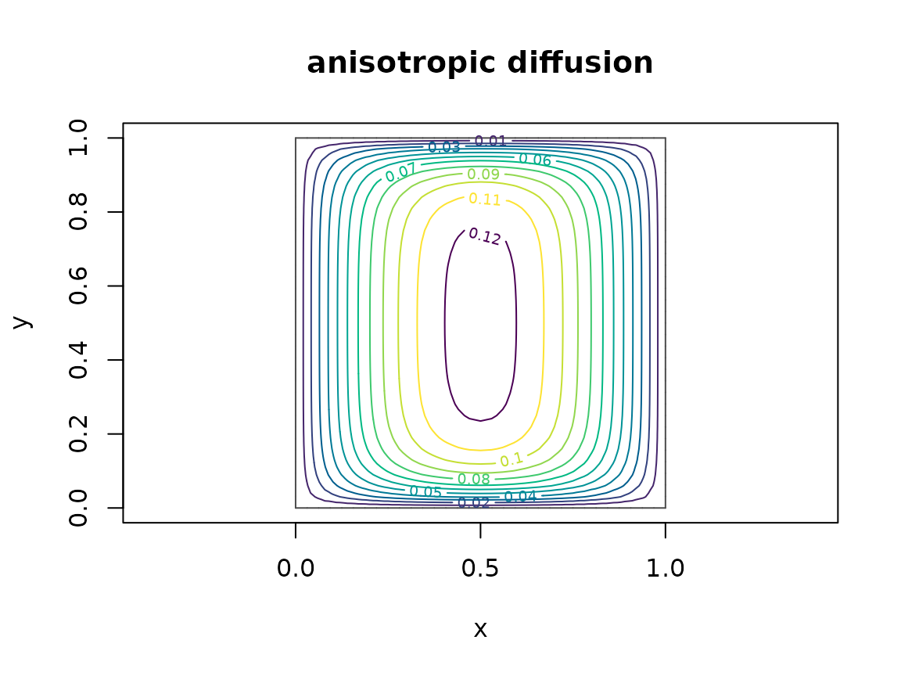

# Solving the Poisson equation

``` r

library(pdecompR)
```

## The model problem

-\nabla\cdot(k\nabla u) = f \\ \text{in } \Omega, \qquad u = g \\
\text{on } \Gamma_D, \qquad k \frac{\partial u}{\partial n} = h \\
\text{on } \Gamma_N .

For k bounded and uniformly positive and \Gamma_D of positive length,
the Lax-Milgram lemma guarantees a unique weak solution, and Cea’s lemma
says the Galerkin solution is the best approximation in the energy norm.
For smooth solutions on shape-regular meshes, P1 elements give

\\u - u_h\\\_{L^2} = O(h^2), \qquad \|u - u_h\|\_{H^1} = O(h),

and P2 elements one order more in each norm.

## A manufactured solution

Choose u = \sin(\pi x)\sin(\pi y); then f = 2\pi^2 \sin(\pi x)\sin(\pi
y) and u = 0 on \partial\Omega.

``` r

exact <- function(x, y) sin(pi * x) * sin(pi * y)
grad_exact <- function(x, y) cbind(pi * cos(pi * x) * sin(pi * y), pi * sin(pi * x) * cos(pi * y))
f <- function(x, y) 2 * pi^2 * sin(pi * x) * sin(pi * y)

mesh <- pde_mesh_rectangle(nx = 32, ny = 32)
problem <- poisson_problem(mesh, source = f, boundary = dirichlet_bc(0))
sol <- solve_pde(problem)
sol
#> <pde_solution> P1, 1089 dofs; solver cholesky (solved), relative residual 3.24e-14
#>   u range [    0, 0.9992]
c(L2 = errornorm(sol, exact, "L2"),
  H1 = errornorm(sol, exact, "H1_semi", gradient = grad_exact))
#>          L2          H1 
#> 0.001350436 0.108975424
```

The discrete solution can be inspected as a filled plot or with contour
lines:

``` r

op <- par(mfrow = c(1, 2))
plot(sol$u, type = "contour", main = "contours")
err <- interpolate(exact, sol$space)
err$values <- sol$u$values - err$values
err$name <- "nodal error"
plot(err, type = "contour")
```



``` r

par(op)
```

## Quadratic elements

`degree = 2` switches to P2 elements; nothing else changes.

``` r

p2 <- poisson_problem(pde_mesh_rectangle(nx = 8), source = f, boundary = dirichlet_bc(0), degree = 2)
convergence_study(p2, exact, grad_exact, mesh_sizes = c(4, 8, 16, 32))
#> Mesh convergence study
#>        h ndof        L2  H1_semi rate_L2 rate_H1_semi
#>  0.35355   81 4.328e-03 0.129389      NA           NA
#>  0.17678  289 5.481e-04 0.033387   2.981        1.954
#>  0.08839 1089 6.874e-05 0.008419   2.995        1.988
#>  0.04419 4225 8.601e-06 0.002110   2.999        1.997
```

## The affine patch test

A linear function is in the P1 space, so with zero source and matching
Dirichlet data the discrete solution must be the exact solution up to
rounding. This checks assembly, boundary enforcement and interpolation
at once, and it holds on any mesh:

``` r

lin <- function(x, y) x + 2 * y
L <- pde_mesh_polygon(rbind(c(0, 0), c(2, 0), c(2, 1), c(1, 1), c(1, 2), c(0, 2)), h = 0.3)
s <- solve_pde(poisson_problem(L, source = 0, boundary = dirichlet_bc(lin)))
max(abs(s$u$values - lin(L$nodes[, 1], L$nodes[, 2])))
#> [1] 2.664535e-15
```

## Variable and anisotropic diffusion

The diffusion coefficient can be a function of position (checked to be
positive at all quadrature points) or a constant symmetric positive
definite matrix.

``` r

k <- function(x, y) 1 + 10 * (x > 0.5)
s <- solve_pde(poisson_problem(pde_mesh_rectangle(nx = 32), diffusion = k, source = 1,
                               boundary = dirichlet_bc(0)))
plot(s, main = "jump in diffusion at x = 0.5")
```



``` r


Ktensor <- matrix(c(1, 0, 0, 0.05), 2)
s2 <- solve_pde(poisson_problem(pde_mesh_rectangle(nx = 32), diffusion = Ktensor, source = 1,
                                boundary = dirichlet_bc(0)))
plot(s2$u, type = "contour", main = "anisotropic diffusion")
```



A coefficient that is not uniformly positive is rejected rather than
silently producing an indefinite system:

``` r

solve_pde(poisson_problem(pde_mesh_rectangle(nx = 4), diffusion = function(x, y) x - 0.5,
                          source = 1, boundary = dirichlet_bc(0)))
#> Error:
#> ! The diffusion coefficient must be positive (minimum -0.4851 at quadrature points).
```

## Behind solve_pde()

[`discretize()`](https://adamrsophie.github.io/pdecompR/reference/discretize.md)
exposes the assembled system:

``` r

disc <- discretize(problem)
disc
#> <pde_discretization> P1, 1089 dofs (961 free), nnz(A) = 7361
dim(disc$A); length(disc$dirichlet$dofs)
#> [1] 1089 1089
#> [1] 128
```

The Dirichlet values are eliminated: with free indices f and Dirichlet
indices d, the solver solves A\_{ff} U_f = b_f - A\_{fd} U_d. The
reduced matrix A\_{ff} keeps the symmetry and definiteness of A, so
Cholesky applies; rows and columns are never overwritten inconsistently.
