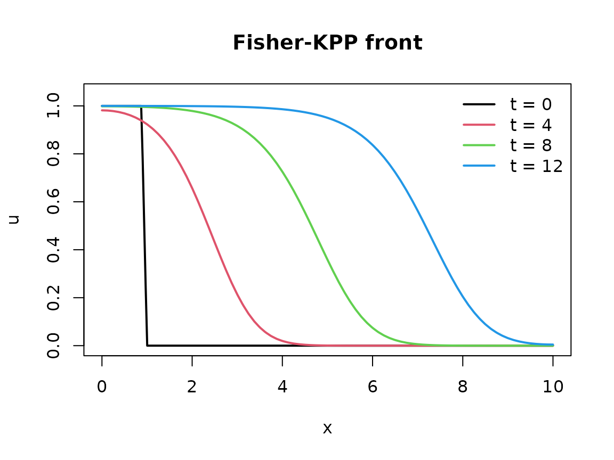
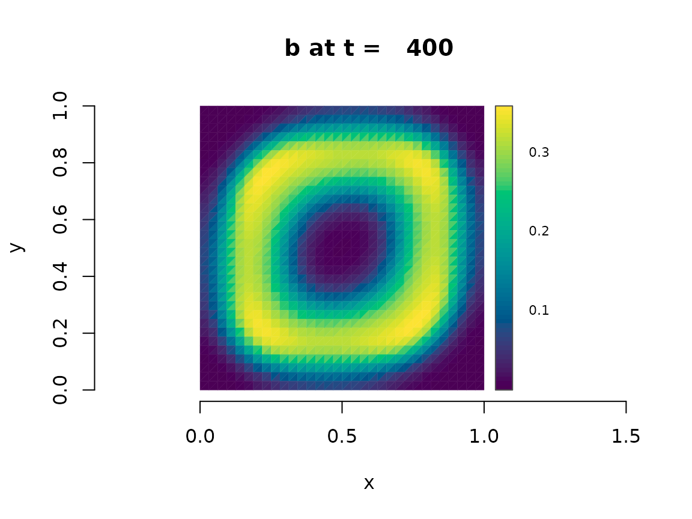

# Reaction-diffusion systems

``` r

library(pdecompR)
```

## Model

A system of S species,

\partial_t u_s - \nabla\cdot(D_s\nabla u_s) = R_s(u_1, \dots, u_S, x,
t), \qquad s = 1, \dots, S,

with per-species diffusion, initial values and boundary conditions.

## Discretization

The reaction term uses the product (group finite-element) approximation:
R is evaluated at the degrees of freedom and integrated as M R(\mathbf
U). This is exact for linear reactions and second-order accurate in
space for smooth nonlinear ones, and it keeps the reaction pointwise, so
Jacobians are cheap.

Two time integrators are available:

- `"imex-euler"`: (M + \Delta t K_s)\mathbf U_s^{n+1} = M(\mathbf
  U_s^n + \Delta t R_s(\mathbf U^n)); diffusion is implicit, the
  reaction explicit, and each species matrix is factored once. Stiff
  reactions need small steps.
- `"implicit-euler"`: the coupled nonlinear system (M_b + \Delta t
  K_b)\mathbf U^{n+1} - \Delta t M_b R(\mathbf U^{n+1}) = M_b \mathbf
  U^n is solved by Newton’s method with a backtracking line search. The
  reaction Jacobian is supplied by the user or computed by finite
  differences, one species at a time.

Neither scheme guarantees positivity for general reactions; check the
solution if positivity matters.

## Fisher-KPP fronts

The Fisher-KPP equation \partial_t u = D\Delta u + r u(1 - u) develops a
traveling front with speed 2\sqrt{rD}.

``` r

mesh <- pde_mesh_rectangle(c(0, 10), c(0, 1), nx = 80, ny = 2)
prob <- reaction_diffusion_problem(
  mesh, species = "u", diffusion = 0.1,
  reaction = function(u, x, y, t) u * (1 - u),
  initial = list(u = function(x, y) as.numeric(x < 1)),
  time = c(0, 12))
sol <- solve_pde(prob, dt = 0.1, method = "implicit-euler", output_times = c(0, 4, 8, 12))
summary(sol)
#> Time-dependent finite-element solution
#>   method: implicit-euler  dt:   0.1  steps: 120 
#>   degrees of freedom: 243  ( 243  free)
#>   linear solver: auto  max relative residual: 5.17e-16 
#>   Newton iterations per step: max 3  mean     3 
#>   integral of the solution, first and last stored time: 0.9375 to 7.069 
#>   assembly 0.016 s, time stepping 0.889 s
xs <- seq(0, 10, length.out = 300)
plot(NULL, xlim = c(0, 10), ylim = c(0, 1.05), xlab = "x", ylab = "u", main = "Fisher-KPP front")
for (k in seq_along(sol$times)) {
  lines(xs, evaluate(solution_at(sol, sol$times[k]), xs, rep(0.5, 300)), col = k, lwd = 2)
}
legend("topright", paste("t =", sol$times), col = seq_along(sol$times), lwd = 2, bty = "n")
```



The front position (where u = 1/2) speeds up toward the asymptotic value
2\sqrt{0.1} \approx 0.63. Fronts that start from step data approach this
speed slowly and from below, so the measured speeds are a little
smaller:

``` r

pos <- sapply(sol$times[-1], function(t) {
  u <- evaluate(solution_at(sol, t), xs, rep(0.5, 300)); xs[which.min(abs(u - 0.5))]
})
diff(pos) / 4
#> [1] 0.5769231 0.6270903
```

## A coupled system: Gray-Scott patterns

The Gray-Scott model

\partial_t a = D_a\Delta a - ab^2 + F(1 - a), \qquad \partial_t b =
D_b\Delta b + ab^2 - (F + \kappa)b

forms spots and stripes. A short run on a coarse mesh:

``` r

Fk <- 0.04; kk <- 0.06
gs <- reaction_diffusion_problem(
  pde_mesh_rectangle(c(0, 1), c(0, 1), nx = 32), species = c("a", "b"),
  diffusion = list(2e-4, 1e-4),
  reaction = function(u, x, y, t) {
    a <- u[, "a"]; b <- u[, "b"]
    cbind(-a * b^2 + Fk * (1 - a), a * b^2 - (Fk + kk) * b)
  },
  initial = list(a = 1, b = function(x, y) 0.5 * exp(-200 * ((x - 0.5)^2 + (y - 0.5)^2))),
  time = c(0, 400))
gsol <- solve_pde(gs, dt = 2, method = "imex-euler", output_times = c(0, 400))
plot(gsol, time = 400, species = "b")
```



## Verification

The test suite checks the solvers against exact solutions:

- linear decay R = -cu with u_0 = \sin\pi x\sin\pi y: u = e^{-(2\pi^2D +
  c)t}u_0;
- logistic growth with spatially constant data and zero flux: the PDE
  reduces to the logistic ODE, and backward Euler shows first-order
  convergence;
- a linear two-species system with constant data: the solution is
  e^{At}u_0.

``` r

r <- 3; u0 <- 0.1
p <- reaction_diffusion_problem(pde_mesh_rectangle(nx = 4), reaction = function(u, x, y, t) r * u * (1 - u),
                                initial = list(u = u0), time = c(0, 1))
exact <- 1 / (1 + (1 / u0 - 1) * exp(-r))
sapply(c(0.04, 0.02, 0.01), function(dt) {
  s <- solve_pde(p, dt = dt, method = "implicit-euler", output_times = 1)
  abs(s$values$u[1, 1] - exact)
})
#> [1] 0.010586883 0.005417825 0.002740184
```
